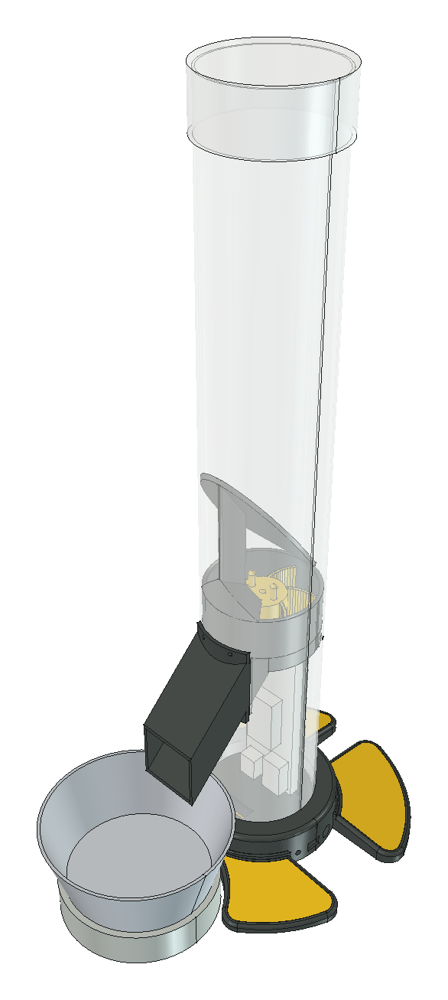
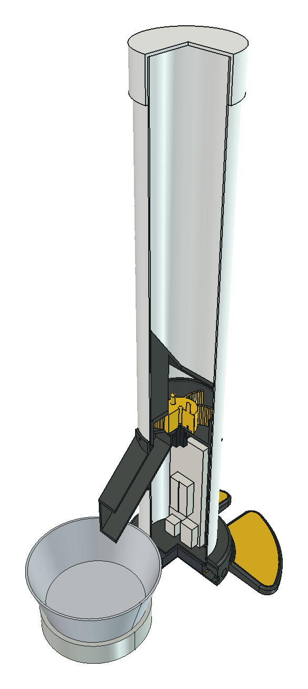

# Alimentador de Pet IoT

Alimentador automático para cães e gatos, feito com tubo de PVC, peças impressas em 3D e um ESP32, que **dosa a ração
por peso**. Uma balança sob a vasilha mede o que caiu e o rotor dosador para quando chega na quantidade programada.
Pelo celular você define os horários e as gramas de cada refeição, serve na hora e acompanha o que foi servido, o
consumo do pet e a bateria.

**Site do projeto (modelo 3D interativo, peças, lista de compras e montagem):**
<https://igorpdsantos.github.io/alimentador-pet-iot/>

**App (abra no celular e use "Adicionar à tela inicial"):** <https://igorpdsantos.github.io/alimentador-pet-iot/app/>

<p align="center">
  
  &nbsp;&nbsp;
  
</p>

## Estado

| Parte | Situação |
|---|---|
| Mecânica e modelo 3D (v3) | ✅ Pronto para imprimir — 13 tipos de peça, ~773 g de PETG |
| Lista de compras, ligações e montagem | ✅ Documentado |
| Site do projeto | ✅ Publicado |
| Firmware do ESP32 | 🧪 Código pronto e testado no PC (40 testes); falta gravar e testar na placa montada |
| App (PWA) | 🧪 Pronto e testado com o simulador; falta testar com o alimentador real |
| Simulador do ESP32 | ✅ Com broker MQTT local, para usar o app sem hardware |

## Como funciona

1. **Programa:** no app, você define até 8 refeições por dia (horário + gramas) ou pede "alimentar agora".
2. **Libera:** o ESP32 gira um rotor de 6 bolsos com um servo de rotação contínua. A balança (HX711 + célula de
   carga de 5 kg) lê o peso na vasilha e o rotor para quando a dose foi atingida.
3. **Informa:** o app mostra quanto foi realmente servido, o consumo ao longo do dia e a bateria.

A agenda fica no ESP32, então as refeições acontecem mesmo sem internet. A energia vem de uma fonte de 12 V, com
6 pilhas AA como no-break.

| | |
|---|---|
| Capacidade | ≥ 1,2 kg de ração (tubo de 640 mm) |
| Controle | ESP32 DOIT DevKit V1, Wi-Fi, MQTT com TLS |
| Dosagem | Malha fechada por peso, com detecção de reservatório vazio/entupido |
| Energia | Fonte 12 V + 6 × AA (no-break), step-down MP1584 |
| Custo estimado | ~R$ 460: ~R$ 263 em peças + R$ 199 de impressão 3D terceirizada ([orçamento](docs/orcamento.md)) |

## Quero montar o meu

1. **Compre os componentes:** [`docs/componentes.md`](docs/componentes.md) (modelos, medidas, onde usar) e
   [`docs/orcamento.md`](docs/orcamento.md) (preços).
2. **Imprima as peças:** os arquivos estão em [`cad/impressao_v3/`](cad/impressao_v3/) (STL e 3MF, já na posição de
   impressão). Material PETG, camada 0,2 mm, 3–4 perímetros, 20 % de preenchimento (rotor P03 e espaçador P09
   com 40 %). Só o chapéu P10 precisa de suporte. Detalhes por peça em
   [`docs/componentes.md` §6](docs/componentes.md#6-peças-impressas).
3. **Monte:** [`docs/passo_a_passo.md`](docs/passo_a_passo.md) (passo a passo) e
   [`docs/montagem.md`](docs/montagem.md) (ligações, uso, troca de pilhas e limpeza).
4. **Grave o firmware e instale o app:** em breve — veja [`firmware/`](firmware/) e [`app/`](app/).

> ⚠️ Algumas medidas dependem das peças que você comprar (diâmetro interno do PVC, tampão, célula de carga, vasilha).
> Elas estão marcadas como "medir" na documentação: confira com um paquímetro antes de imprimir.

## Estrutura do repositório

```
cad/            Modelo 3D (FreeCAD 1.1): IoT3D_v3.FCStd, peças para imprimir, montagem detalhada, scripts e renders
  impressao_v3/   STL + 3MF de cada peça
  scripts/        geração das peças por Python (gerar_v3.py), exportação, orçamento de impressão
  montagem/       montagem completa com componentes, fios e parafusos
  historico/      versões anteriores (v1, v2)
docs/           Documentação de montagem: componentes, orçamento, passo a passo, estudos
specs/          Especificações (fonte da verdade): sistema, hardware, mecânica, firmware, protocolo MQTT, app, testes
firmware/       Código do ESP32 (PlatformIO + Arduino); lógica pura em lib/core com testes no PC
app/            App PWA (Vite + React + TypeScript), instalável no celular
tools/          Simulação DEM do dosador, simulador do ESP32, exemplos do contrato MQTT
site/           Site estático do projeto, publicado no GitHub Pages
```

## Documentação técnica

| Documento | Conteúdo |
|---|---|
| [01 — Sistema](specs/01-sistema.md) | Requisitos, arquitetura, fluxo de uma refeição |
| [02 — Hardware](specs/02-hardware.md) | Materiais, pinagem, alimentação, divisor da bateria, autonomia |
| [03 — Mecânica](specs/03-mecanica.md) | Peças, rotor dosador, chapéu, pedestal, balança, patas |
| [04 — Firmware](specs/04-firmware.md) | Tasks, dosagem em malha fechada, bateria, agenda, histórico |
| [05 — Protocolo MQTT](specs/05-protocolo-mqtt.md) | Contrato app ↔ firmware: tópicos, comandos, eventos, erros |
| [06 — App (PWA)](specs/06-app-mobile.md) | Telas e regras do app |
| [07 — Testes e métricas](specs/07-testes-e-metricas.md) | Testes de bancada e métricas |
| [Decisões de projeto](specs/README.md) | Por que cada escolha foi feita |

## Editar o modelo 3D

As peças são geradas por script, então mudanças de geometria vão no Python, não no `.FCStd`:

```bash
freecadcmd cad/scripts/gerar_v3.py                # gera cad/IoT3D_v3.FCStd e roda as verificações
freecadcmd cad/scripts/exportar_para_impressao.py # exporta STL + 3MF para cad/impressao_v3/
```

Rode da raiz do repositório. No macOS, o `freecadcmd` fica em `/Applications/FreeCAD.app/Contents/Resources/bin/`.
Para ver a montagem com texturas, abra `cad/montagem/abrir_montagem.FCMacro` no FreeCAD.

## Créditos

Ideia inicial: [ped_feeder](https://github.com/arthurmacedo01/ped_feeder), de Arthur Macedo.

Desenvolvido como trabalho da disciplina de Sistemas Automatizados.

## Licença

- **Código** (firmware, app, site, scripts e ferramentas): [MIT](LICENSE).
- **Modelos 3D, documentação e imagens** (`cad/`, `docs/`, `specs/`, imagens do site): [CC BY-NC-SA 4.0](LICENSE-CC-BY-NC-SA-4.0.txt).
  Pode fazer, modificar e compartilhar, dando crédito e mantendo a mesma licença, mas **sem uso comercial**
  (não vender peças, kits ou alimentadores feitos a partir do projeto).
