# Manual de montagem — Alimentador v3

> Gerado por `site/ferramentas/capturar_manual.mjs` a partir de `site/manual/passos.js` — **não edite à mão**.
> Versão interativa (gira, aproxima e anima cada passo): `site/manual.html` (no site do projeto: **Manual 3D**).

Legenda das imagens: **amarelo = peça que entra neste passo**, cinza = o que já está montado, translúcido = só referência
(ex.: o tubo, para ver por dentro). A seta tracejada mostra o caminho da peça até o lugar dela.

Tipos de trabalho: 🔧 Mecânica · 🔩 Parafusos · 🔌 Eletrônica · 🔥 Solda · 🧴 Cola · 📏 Medir/marcar · ✅ Teste

## Módulos

| Módulo | O que é | Tipo | Depende de | Tempo |
|---|---|---|---|---|
| **0** Antes de começar | Conferir peças, medidas e ferramentas; dividir o grupo. Todo mundo junto. | conferência | — | 40 min |
| **A** Tubo de PVC | Cortar, marcar e furar o tubo e abrir a janela da bica. Faz sujeira: fazer longe da eletrônica. | 🔧 📏 mecânica pesada (furadeira) | — | 1 h |
| **B** Cartucho dosador | Servo + rotor + anel/escudo + chapéu: o mecanismo que solta a ração. Montado na mão, fora do tubo. | 🔧 🔩 mecânica fina | — | 40 min |
| **C** Pedestal e gaveta | Pés, ímãs, jack, chave, botão, LED e a gaveta com as 6 pilhas. | 🔥 🔧 🧴 solda + mecânica | — | 1 h 15 |
| **D** Eletrônica na protoboard | Regulador em 5 V, componentes furo a furo, jumpers, ESP32 e gravação do firmware. Fazer numa mesa limpa. | 🔌 🔥 eletrônica | — | 2–3 h |
| **E** Balança | Célula de carga entre a base e a plataforma, com os 3 batentes de proteção. | 🔩 🔥 mecânica + solda leve | — | 40 min |
| **F** Patas com lastro | Encher as 4 patas com peso, colar as tampas e os pés de borracha. | 🧴 mecânica leve | — | 30 min |
| **G** Montagem final | Juntar os módulos: eletrônica no pedestal, ligações, balança, teste geral, tubo, patas, calibração. | 🔌 🔩 ✅ todos | A, B, C, D, E, F | 1 h 30 |

## 0 — Antes de começar

Conferir peças, medidas e ferramentas; dividir o grupo. Todo mundo junto.

### 0.1 Visão geral: o que vamos montar

✅ Teste · ⏱ 10 min

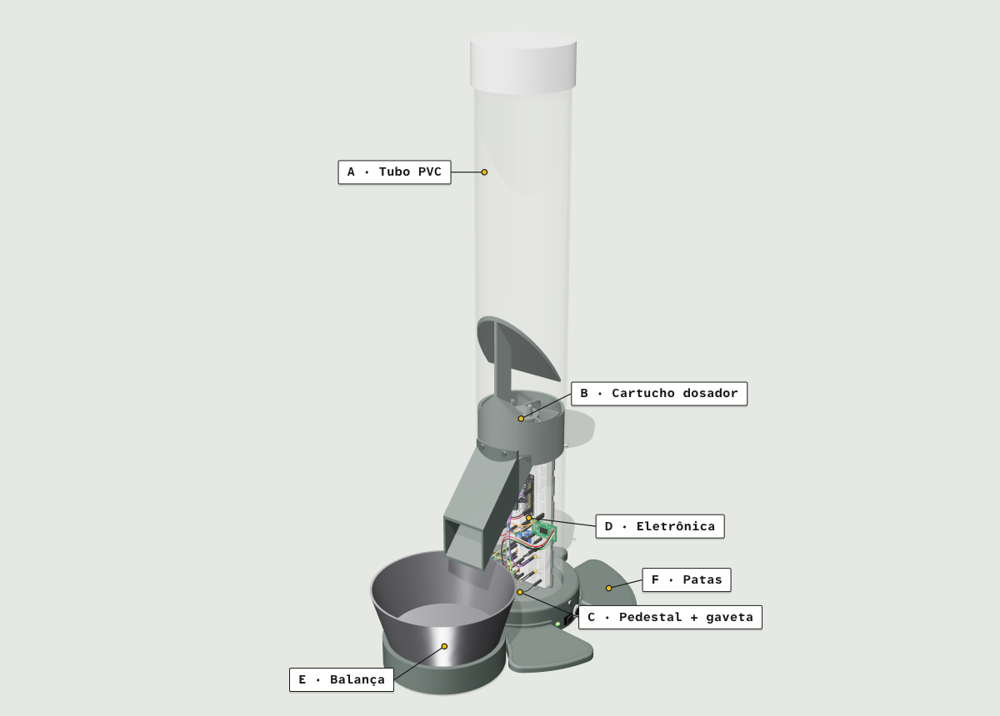

O alimentador tem **6 módulos independentes** (A–F) que juntam na **montagem final (G)**. Cada módulo pode ser feito por uma dupla ao mesmo tempo.

**Divisão sugerida (grupo de 8):**

| Dupla | Módulos | Tipo de trabalho |
|---|---|---|
| 1 | **A** Tubo → **B** Cartucho | furadeira, micro-retífica, chave fina |
| 2 | **C** Pedestal → **F** Patas | solda simples, cola, parafusos |
| 3 | **D** Eletrônica | protoboard, multímetro, solda dos pinos do regulador, computador |
| 4 | **E** Balança → ajuda a dupla 3 | parafusos, solda de 4 fios |

✅ **Confira antes de seguir:**

- [ ] Cada dupla sabe o seu módulo e já separou as peças dele (próximos passos).

### 0.2 Mapa das peças impressas (P01–P13)

✅ Teste · ⏱ 15 min

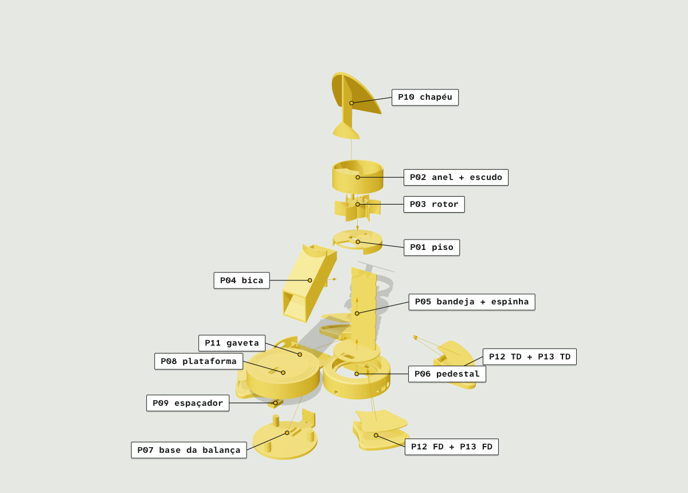

As 19 peças impressas, afastadas na ordem em que se encaixam. Use esta vista para reconhecer cada uma. **Marque com caneta** o código em cada peça assim que sair da impressora (principalmente as 4 patas e as 4 tampas, que são diferentes entre si).

**Separe:**

| Qtd | Item |
|---|---|
| 19 | peças impressas — P01–P11 (1 de cada), P12 × 4 (TD, TE, FE, FD), P13 × 4 (TD, TE, FE, FD) |

**Faça:**

1. Tire suportes e rebarbas de todas as peças.
2. Escreva o código (P01…P13, e TD/TE/FE/FD nas patas e tampas) com caneta permanente num lugar que não fique à vista.
3. Passe uma broca de **2,5 mm na mão** (sem furadeira) nos furos-guia dos parafusos M3: só para tirar a sujeira da impressão.
4. Passe uma broca de **3,5 mm na mão** nos furos de passagem: aba do braço da base (P07) e moldura da bica (P04).

✅ **Confira antes de seguir:**

- [ ] As 6 pás do rotor (P03) estão inteiras, sem trinca na raiz.
- [ ] O chapéu (P10) não tem rebarba; os 2 pinos de baixo estão inteiros.

### 0.3 Medir as peças compradas (paquímetro)

📏 Medir/marcar · ⏱ 15 min

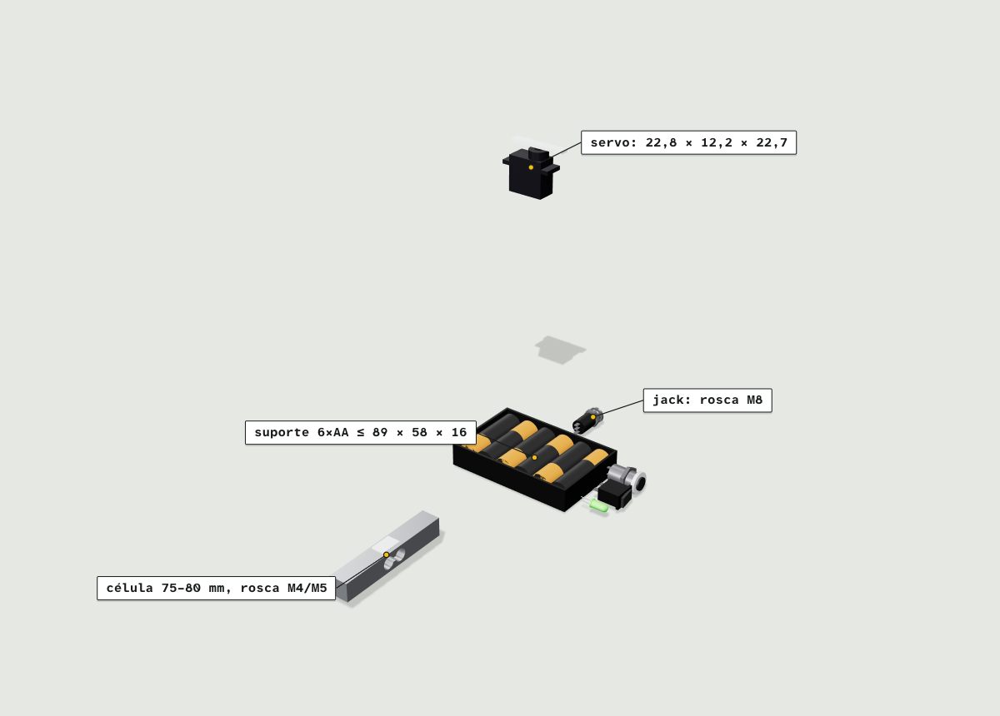

Algumas medidas do projeto são de anúncio (⚠️). Confira com paquímetro **antes** de furar ou forçar qualquer coisa. Se algo não bater, avise quem cuida do CAD (parâmetros no topo de `cad/scripts/gerar_v3.py`).

| O quê | Medida esperada | Se não bater |
|---|---|---|
| Tubo PVC — diâmetro **interno** | **≥ 97,8 mm** (DE 101,6 × 1,8) | Cartucho não entra: não compre série reforçada |
| Servo MG90S — corpo | 22,8 × 12,2 × 22,7 mm; furos das abas a 27,8 mm | Furar no lugar certo com broca 1,5 mm |
| Servo — do fundo ao topo do eixo | 31,0 mm | Rotor pode raspar no piso |
| Célula de carga | 75 ou 80 × 12,7 × 12,7 mm; rosca M4 ou M5 | Escolher os parafusos (M4 ou M5 × 16) |
| Suporte 6×AA | ≤ 89 × 58 × 16 mm (1 camada) | Não cabe na gaveta |
| Jack P4 | rosca M8, porca ≤ Ø 13 mm | — |
| Braço duplo do servo | ≤ 36 × 6 × 2 mm | Lixar as pontas |

**Ferramentas:** paquímetro, multímetro.

✅ **Confira antes de seguir:**

- [ ] Servo é o **de rotação contínua (360°)**: girando o eixo com a mão ele não para em um ângulo fixo.
- [ ] Suporte de pilhas é o **chato** (6 lado a lado).

## A — Tubo de PVC

Cortar, marcar e furar o tubo e abrir a janela da bica. Faz sujeira: fazer longe da eletrônica.

### A.1 Cortar o tubo e marcar as 4 linhas

📏 Medir/marcar · 🔧 Mecânica · ⏱ 20 min

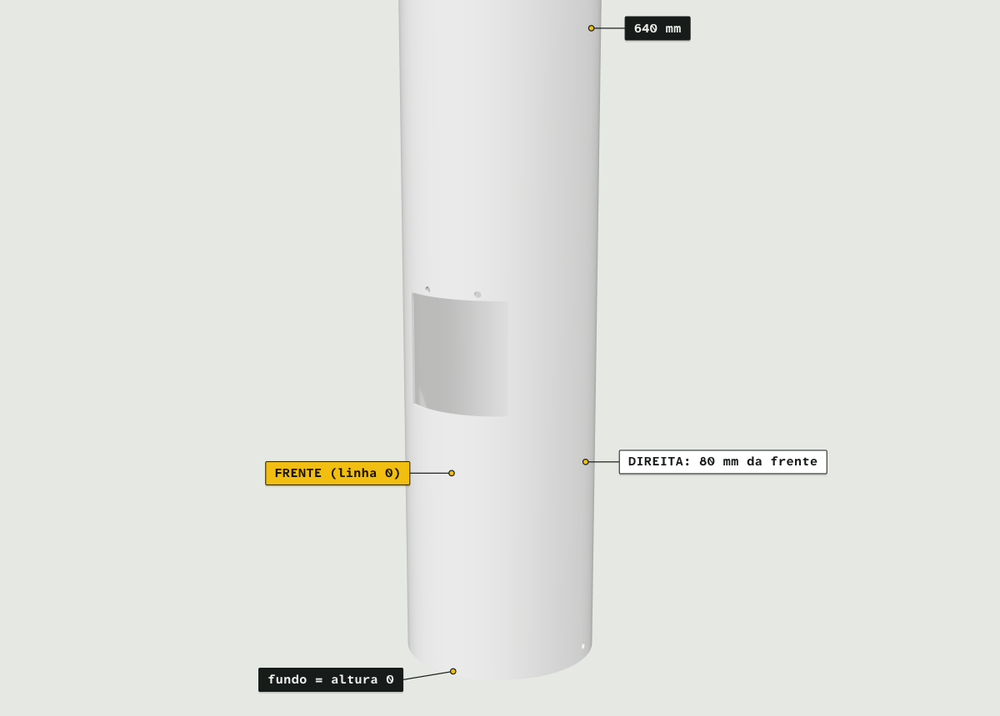

Só **duas peças** são parafusadas no tubo: o **piso do dosador** (P01), por **3 furos atrás**, e a **bica** (P04), por **2 furos na frente**, logo acima da janela. Esses 2 parafusos da bica atravessam a moldura e o tubo e rosqueiam no **anel** (P02), travando os dois. O servo vem preso no piso e o **chapéu não leva parafuso**: fica apoiado no escudo. Todas as alturas são medidas **a partir do fundo** do tubo (a ponta que vai no pedestal) e todas as distâncias em volta do tubo, **pela fita** (perímetro = **319 mm**).

**Separe:**

| Qtd | Item |
|---|---|
| 1 | tubo PVC esgoto DN 100 série normal — pedaço ≥ 65 cm |
| — | fita crepe, caneta permanente |

**Ferramentas:** serra para PVC (ou arco de serra), esquadro ou folha de papel enrolada como guia, trena, lixa 120.

**Faça:**

1. Enrole uma folha de papel bem esticada em volta do tubo e risque o corte seguindo a borda do papel: fica no esquadro.
2. Corte em **640 mm** e lixe as rebarbas de dentro e de fora.
3. Escolha uma ponta para ser o **fundo** e escreva "FUNDO" nela.
4. Enrole fita crepe nos primeiros 25 cm a partir do fundo. Risque uma linha reta de cima a baixo na fita: **FRENTE**.
5. Medindo pela fita (em volta do tubo) a partir da FRENTE: **80 mm** para cada lado = **DIREITA** e **ESQUERDA**; **160 mm** = **TRÁS**.
6. Ainda a partir da FRENTE, marque **106 mm** para cada lado (passando por trás): são as linhas de **30°** e **150°** dos furos do cartucho.

✅ **Confira antes de seguir:**

- [ ] De TRÁS até a linha de 30° e até a de 150° dá ~53 mm (as duas iguais); da DIREITA até a de 30° dá ~27 mm.
- [ ] As linhas estão paralelas ao tubo (confira com uma régua encostada).

### A.2 Furar os 7 furos de Ø 3,5 mm

📏 Medir/marcar · 🔧 Mecânica · ⏱ 20 min

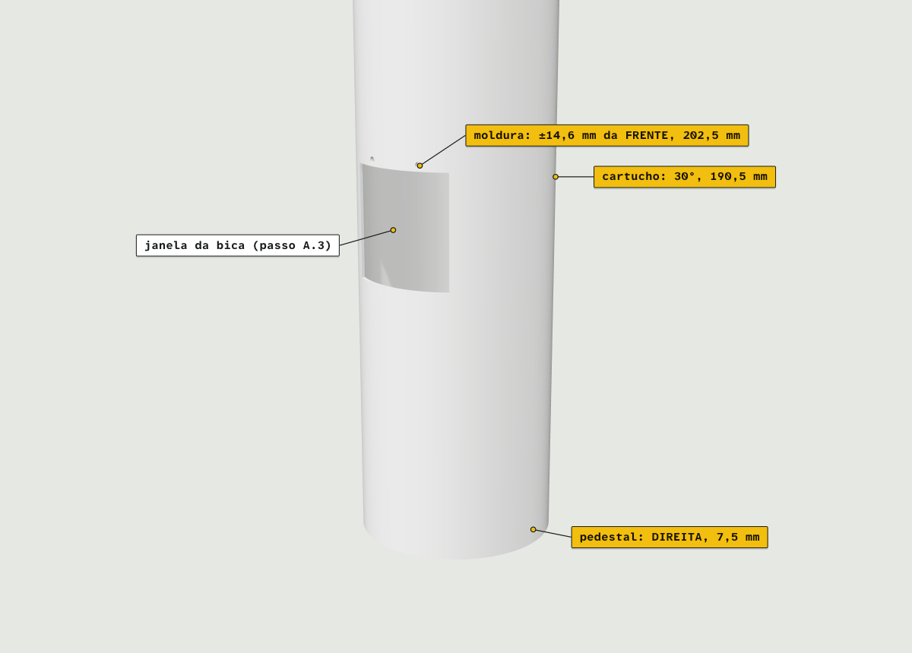

Marque o centro de cada furo com um prego e uma batidinha (a broca não escorrega). Fure **perpendicular** ao tubo, devagar, sem atravessar a parede do outro lado.

| Furo | Linha | Altura (do fundo) | Qtd | Parafuso (depois) | Prende |
|---|---|---|---|---|---|
| Pedestal | DIREITA e ESQUERDA | **7,5 mm** | 2 | **M3 × 20** | pedestal: a ponta entra no furo como pino (G) |
| Cartucho | TRÁS, 30° e 150° | **190,5 mm** | 3 | **M3 × 10** | piso P01 (B.7) |
| Moldura da bica | **14,6 mm** pela fita, à direita e à esquerda da FRENTE | **202,5 mm** | 2 | **M3 × 8** | moldura → tubo → anel P02 (B.8) |

**Ferramentas:** furadeira, broca 3,5 mm, prego e martelo, trena.

**Faça:**

1. Marque as 7 alturas nas linhas certas (tabela) e confira cada uma duas vezes.
2. Fure com broca de **3,5 mm**. Tire as rebarbas de dentro do tubo com a lixa enrolada num dedo.

> ⚠️ **Atenção**
> - O furo do pedestal é **muito perto da borda** (7,5 mm): fure devagar para o PVC não rachar.
> - Os furos da moldura ficam **acima** da janela (202,5 mm; a janela acaba em 199,5 mm). Não confunda com os 3 de trás, que ficam mais baixos (190,5 mm).

✅ **Confira antes de seguir:**

- [ ] 7 furos, nas alturas da tabela (meça de novo depois de furar).
- [ ] Atrás: 3 furos na mesma altura. Na frente: 2 furos lado a lado, ~29 mm um do outro, centrados na linha da FRENTE.

### A.3 Abrir a janela da bica

📏 Medir/marcar · 🔧 Mecânica · ⏱ 25 min

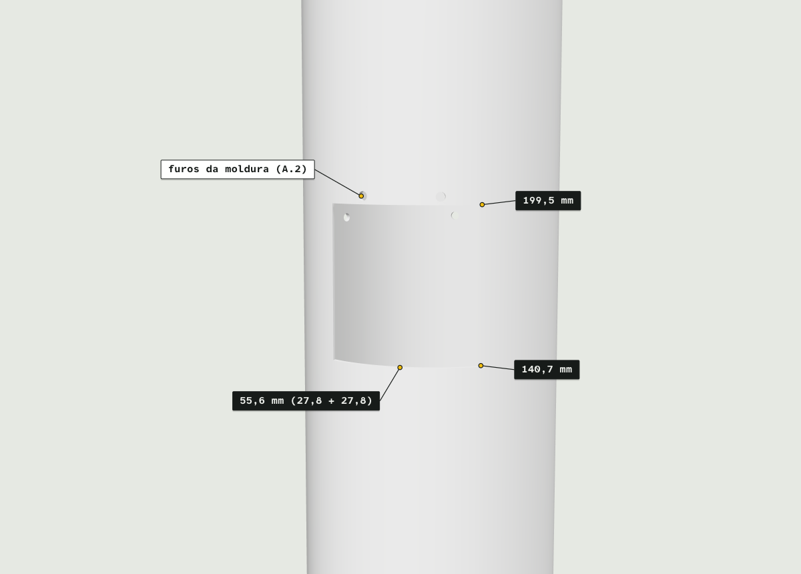

Retângulo centrado na linha da FRENTE: **55,6 mm de largura** (27,8 mm para cada lado da linha) × **de 140,7 a 199,5 mm** de altura. Os 27,8 mm são em **linha reta**; pela fita, em volta do tubo, dariam ~29,4 mm. Marque **27,8 mm pela fita**: a janela sai um pouco menor e a lima acerta.

**Ferramentas:** furadeira + broca 8 mm, micro-retífica com disco de corte ou serra tico-tico, lima, óculos de proteção.

**Faça:**

1. Desenhe o retângulo na fita crepe com régua.
2. Fure os **4 cantos por dentro do retângulo** com broca de 8 mm.
3. Corte de furo a furo **por dentro da linha** (sobra 1 mm para acertar com a lima).
4. Lime até a bica (P04) entrar pela janela **sem forçar**. As bordas de cima e de baixo ficam escondidas pela moldura; as laterais ficam à vista, então deixe-as retas.

✅ **Confira antes de seguir:**

- [ ] P04 entra pela janela e a moldura cobre as bordas de cima e de baixo.
- [ ] Os 2 furos da moldura (A.2) coincidem com os 2 furos da moldura da bica.

## B — Cartucho dosador

Servo + rotor + anel/escudo + chapéu: o mecanismo que solta a ração. Montado na mão, fora do tubo.

### B.1 Teste a seco: piso + rotor + anel

🔧 Mecânica · ✅ Teste · ⏱ 5 min

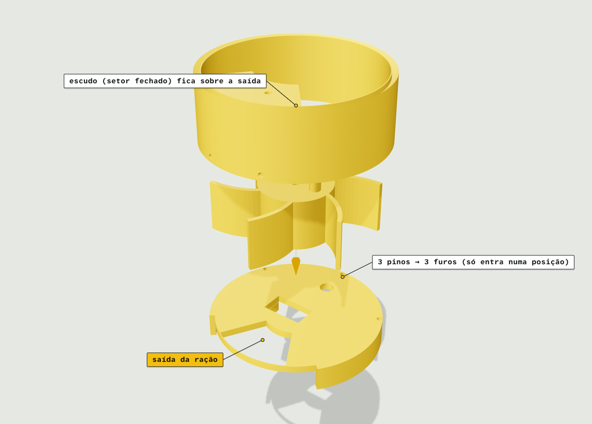

Antes de pôr o servo, confira se as três peças do dosador se encaixam e o rotor gira solto.

**Faça:**

1. Ponha o rotor (P03) sobre o piso (P01).
2. Encaixe o anel (P02) por cima, com os **3 pinos** nos 3 furos do piso. Ele só entra numa posição.
3. Gire o rotor com o dedo pelo meio, nos dois sentidos.
4. Desmonte (o servo entra antes do anel).

✅ **Confira antes de seguir:**

- [ ] O rotor gira **livre** nos dois sentidos, sem raspar.
- [ ] O escudo (parte fechada do anel) fica exatamente em cima da abertura de saída do piso.

### B.2 Servo no piso

🔧 Mecânica · 🔩 Parafusos · ⏱ 10 min

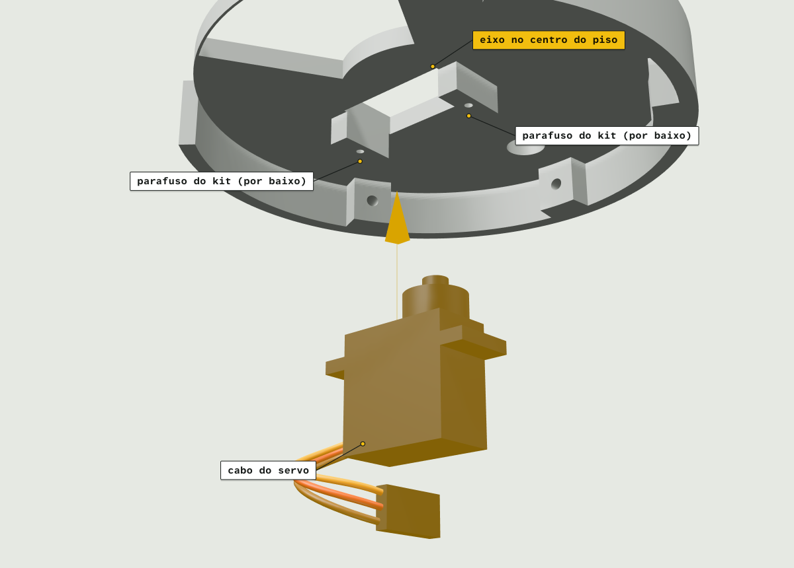

O servo entra **por baixo** do piso: o topo (caixa de engrenagens) passa pela abertura retangular e o **eixo fica no centro** do piso. As abas apoiam por baixo nos 2 apoios.

**Separe:**

| Qtd | Item |
|---|---|
| 1 | P01 piso do dosador |
| 1 | servo **MG90S 360°** |
| 2 | parafusos das abas — vêm no saquinho do servo |

**Ferramentas:** chave Phillips fina #0.

**Faça:**

1. Vire o piso de cabeça para baixo.
2. Encaixe o servo com o eixo para cima, passando a caixa de engrenagens pela abertura retangular. O **eixo** tem que ficar no **centro** do piso.
3. Aparafuse as **2 abas** nos 2 apoios com os parafusos do kit, até encostar. Não force: o furo-guia é no plástico.

> ⚠️ **Atenção**
> - Se o furo da aba não coincidir com o furo do apoio, **não force**: fure o lugar certo com broca de 1,5 mm na mão.

✅ **Confira antes de seguir:**

- [ ] O servo está firme, sem folga; o eixo está centrado.

### B.3 Braço duplo no rotor

🔧 Mecânica · 🔩 Parafusos · ⏱ 5 min

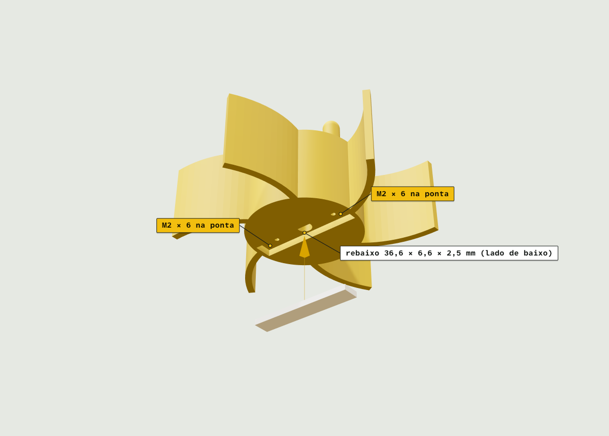

O braço duplo reto do kit encaixa no **rebaixo de baixo** do rotor e é preso por 2 parafusos M2 × 6 nas pontas.

**Separe:**

| Qtd | Item |
|---|---|
| 1 | P03 rotor |
| 1 | braço **duplo reto** do servo |
| 2 | M2 × 6 autoatarraxante |

**Ferramentas:** chave Phillips #0.

**Faça:**

1. Vire o rotor de cabeça para baixo e encaixe o braço no rebaixo, com o furo estriado do braço no centro.
2. Prenda com **2 × M2 × 6** pelos furos das pontas do braço.

✅ **Confira antes de seguir:**

- [ ] O braço fica embutido (não sobra para fora do fundo do rotor).

### B.4 Rotor no eixo do servo

🔧 Mecânica · 🔩 Parafusos · ⏱ 5 min

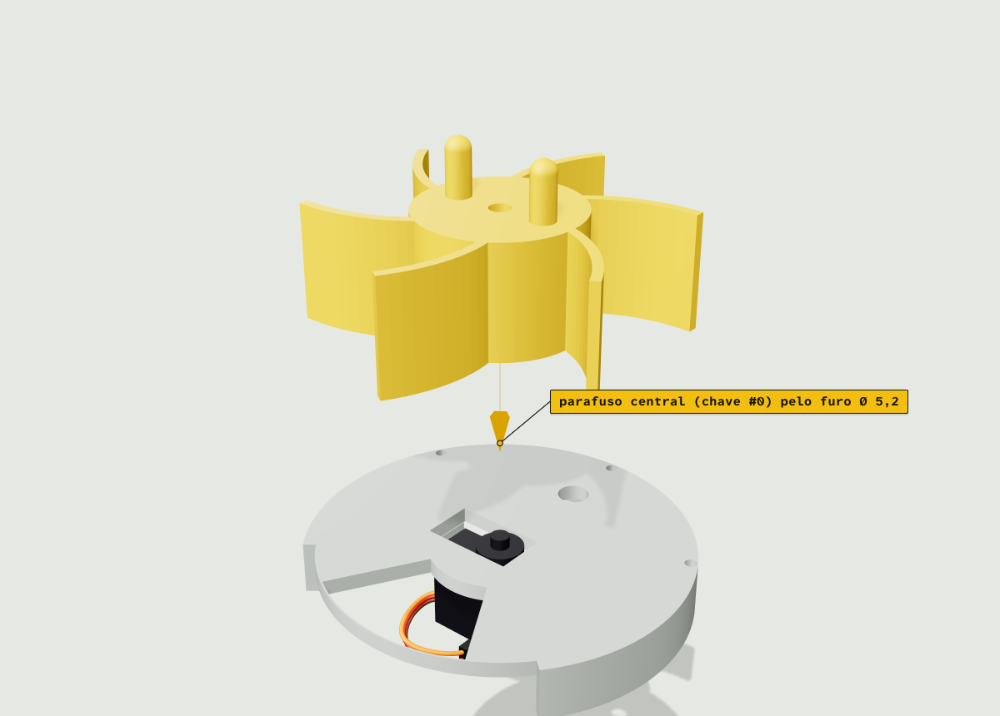

O rotor (com o braço) encaixa no estriado do eixo e é preso pelo **parafuso central** do kit, apertado pelo furo do meio do rotor.

**Separe:**

| Qtd | Item |
|---|---|
| 1 | parafuso central do braço — vem no kit do servo |

**Ferramentas:** chave Phillips fina #0.

**Faça:**

1. Encaixe o rotor no eixo do servo, apertando para baixo até o estriado entrar todo.
2. Aperte o **parafuso central** pelo furo do meio do rotor.
3. Gire o rotor com a mão (devagar: o servo gira junto, com resistência).

✅ **Confira antes de seguir:**

- [ ] O rotor não raspa no piso em nenhuma posição (há 0,8 mm de folga).

### B.5 Anel com escudo

🔧 Mecânica · ⏱ 2 min

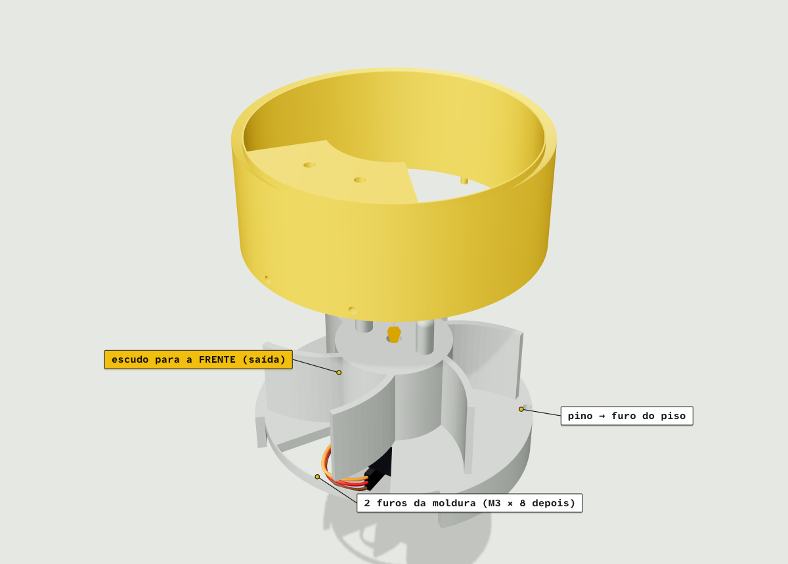

O anel encaixa no piso pelos **3 pinos** (só entra numa posição). O **escudo** (setor fechado) fica por cima da saída da ração, protegendo-a do peso da coluna.

**Faça:**

1. Encaixe o anel pelos 3 pinos, com o escudo sobre a saída.
2. Gire o rotor com o dedo, pelos bolsos.

✅ **Confira antes de seguir:**

- [ ] O rotor gira sem raspar no anel nem no escudo.

### B.6 Chapéu sobre o escudo

🔧 Mecânica · ⏱ 2 min

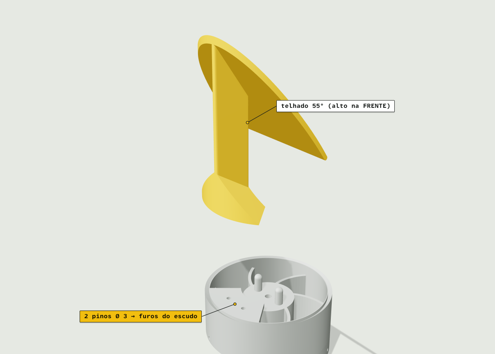

O chapéu tem **2 pinos** que entram nos 2 furos do topo do escudo. Ele fica **solto**: o peso da ração o segura. O telhado alto vai para a FRENTE e a aresta de baixo atravessa o tubo.

**Faça:**

1. Encaixe os 2 pinos do chapéu nos 2 furos do topo do escudo.
2. Pronto: o cartucho vai inteiro para o tubo no passo G (ou já, se o tubo estiver pronto: passo B.7).

✅ **Confira antes de seguir:**

- [ ] O chapéu assenta reto, sem balançar, e o rotor continua girando livre.

### B.7 Cartucho dentro do tubo

🔧 Mecânica · 🔩 Parafusos · ⏱ 15 min

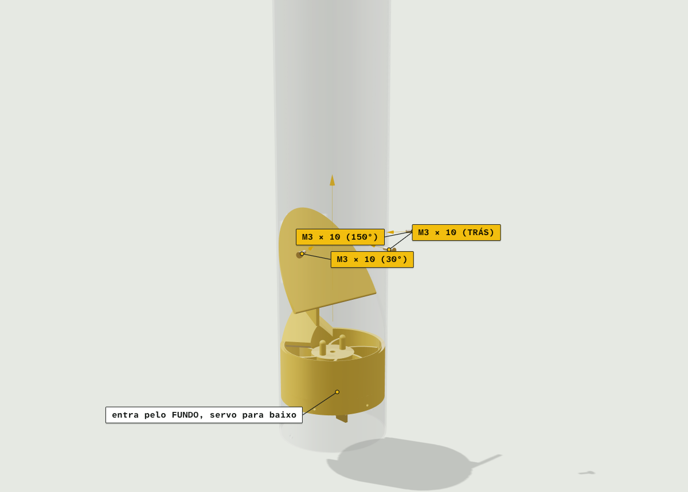

O cartucho entra **pelo fundo** do tubo e sobe até os 3 furos de trás. Faça com o tubo **em pé** (não de cabeça para baixo): assim o chapéu fica apoiado no escudo pela gravidade e não cai.

**Separe:**

| Qtd | Item |
|---|---|
| 1 | cartucho montado (B.1–B.6) |
| 1 | tubo pronto (A.1–A.3) |
| 3 | M3 × 10 inox cabeça panela |

**Ferramentas:** chave Phillips #1, ajudante para segurar o tubo.

**Faça:**

1. Um colega segura o tubo **em pé**, com o fundo uns 30 cm acima da mesa (ou na beira da mesa).
2. Por baixo, empurre o cartucho para dentro com o **chapéu em cima** e o **servo para baixo**, com a **saída virada para a janela** (FRENTE).
3. Suba até os 3 furos do piso aparecerem nos 3 furos de trás do tubo (190,5 mm). Gire o cartucho de leve até alinhar.
4. Aparafuse **3 × M3 × 10** por fora (TRÁS, 30°, 150°). Aperte até encostar; não force (rosca no plástico).
5. Deixe o **cabo do servo pendurado** para fora do fundo do tubo.

> ⚠️ **Atenção**
> - Não monte com o tubo de cabeça para baixo: o chapéu só está encaixado por 2 pinos e cairia tubo abaixo.
> - Aqui são os **M3 × 10** (os mais compridos dos dois). Os M3 × 8 são para a bica (B.8).

✅ **Confira antes de seguir:**

- [ ] Olhando pela janela da bica, a saída do piso está centrada nela.
- [ ] O cartucho não gira nem desce ao empurrar.

### B.8 Bica pela janela

🔧 Mecânica · 🔩 Parafusos · ⏱ 5 min

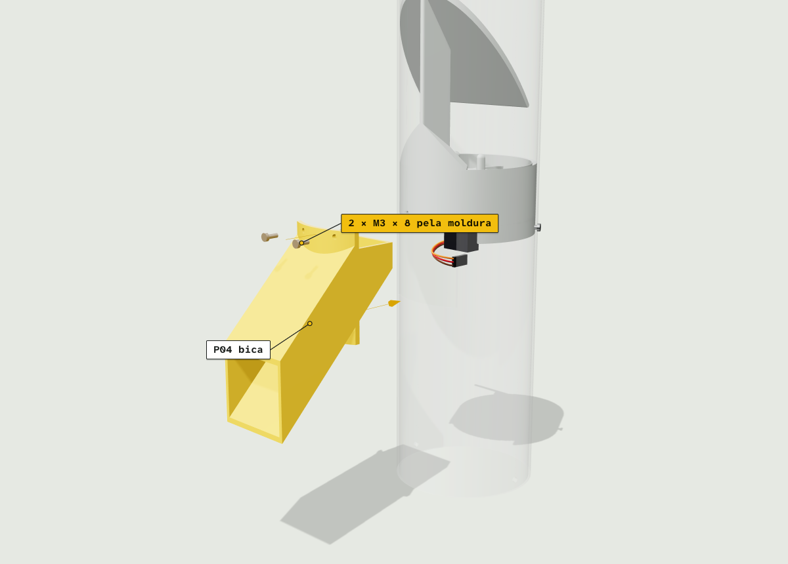

A bica entra **por fora**, pela janela, até encostar embaixo do piso. Os 2 parafusos da moldura atravessam a moldura, o tubo e prendem no anel: travam bica **e** anel.

**Separe:**

| Qtd | Item |
|---|---|
| 1 | P04 bica |
| 2 | M3 × 8 inox cabeça panela |

**Faça:**

1. Passe a bica pela janela, inclinada para baixo, até a ponta de dentro encostar embaixo do piso.
2. Alinhe os 2 furos da moldura com os 2 furos do tubo (202,5 mm).
3. Aparafuse **2 × M3 × 8**.

> ⚠️ **Atenção**
> - Use **M3 × 8**, não M3 × 10: a ponta do M3 × 8 para 0,8 mm antes da face de dentro do anel. Um M3 × 10 passaria da parede e ficaria a 0,2 mm das pás do rotor.

✅ **Confira antes de seguir:**

- [ ] A bica não balança e a moldura cobre as bordas de cima e de baixo da janela.
- [ ] No teste G.5, com um punhado de ração no tubo, ela sai **só pela bica**.

## C — Pedestal e gaveta

Pés, ímãs, jack, chave, botão, LED e a gaveta com as 6 pilhas.

### C.1 Pés de borracha do pedestal

🧴 Cola · ⏱ 5 min

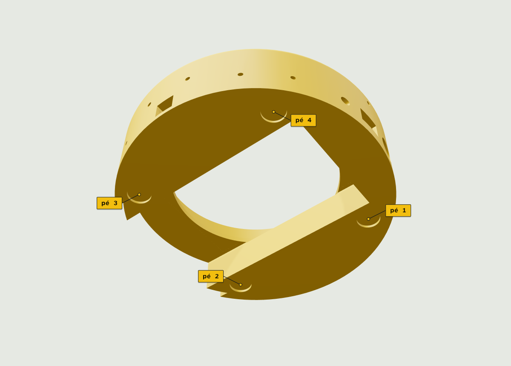

4 pés adesivos nos 4 rebaixos redondos (Ø 12 mm) embaixo do pedestal. São **obrigatórios**: a gaveta das pilhas fica só 0,3 mm acima do fundo e os pés dão a folga para ela não arrastar na mesa.

**Separe:**

| Qtd | Item |
|---|---|
| 4 | pés de borracha adesivos Ø 12 × 3–5 mm — **todos da mesma altura** (as patas usam mais 4 iguais) |

**Faça:**

1. Limpe os rebaixos com álcool.
2. Cole um pé em cada rebaixo, apertando 10 s.

✅ **Confira antes de seguir:**

- [ ] O pedestal apoia nos 4 pés sem mancar.

### C.2 Soldar fios no jack, chave, botão e LED

🔥 Solda · ⏱ 25 min

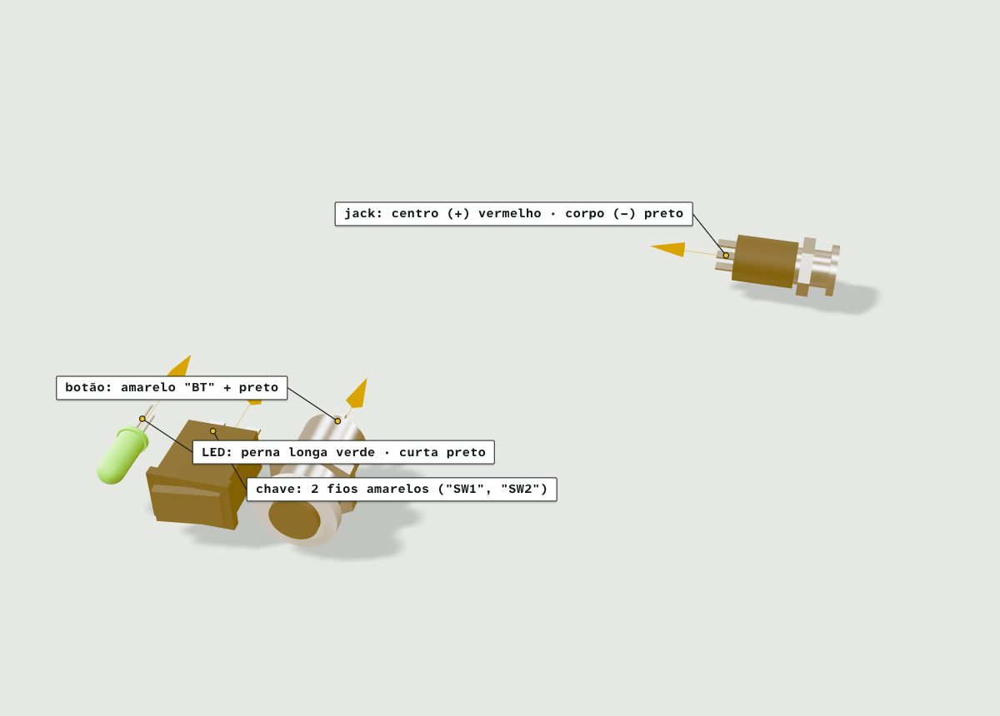

Cada componente do painel ganha fios de **~25 cm** com um **pino macho** na ponta (meio jumper macho-macho emendado), para espetar na protoboard depois. Solde **antes** de pôr no pedestal.

| Componente | Terminal | Fio | Etiqueta |
|---|---|---|---|
| Jack P4 | pino central (+) | vermelho | "J+" |
| Jack P4 | corpo (−) | preto | "J−" |
| Chave KCD11 | terminal 1 | amarelo | "SW1" |
| Chave KCD11 | terminal 2 | amarelo | "SW2" |
| Botão | terminal 1 | amarelo | "BT" |
| Botão | terminal 2 | preto | "BT−" |
| LED | perna **longa** (anodo) | verde | "LED+" |
| LED | perna curta (catodo, lado chato) | preto | "LED−" |

**Separe:**

| Qtd | Item |
|---|---|
| 1 | jack P4 de painel 5,5 × 2,1 (com porca) |
| 1 | chave KCD11 |
| 1 | botão 12 mm NA (com porca) |
| 1 | LED 5 mm |
| 8 | fios de ~25 cm — AWG 22–24 |
| 4 | jumpers macho-macho — cortados ao meio = 8 pontas |
| — | termorretrátil Ø 2–3 mm |

**Ferramentas:** ferro de solda + estanho, desencapador, isqueiro ou soprador, fita crepe para as etiquetas.

**Faça:**

1. Tire as **porcas** do jack e do botão e guarde: elas entram **por dentro** do pedestal (C.3 e C.4).
2. Ponha um pedaço de termorretrátil no fio antes de cada solda.
3. Solde os 8 fios conforme a tabela. Cubra cada solda com o termorretrátil e encolha.
4. Na outra ponta de cada fio, emende meio jumper (pino macho) e isole.
5. Etiquete cada fio com fita crepe (coluna "Etiqueta").

✅ **Confira antes de seguir:**

- [ ] Multímetro em continuidade: chave só apita **ligada**; botão só apita **apertado**.
- [ ] LED acende com 3 V (2 pilhas AA) com a perna longa no +.

### C.3 Jack P4 na traseira

🔧 Mecânica · ⏱ 5 min

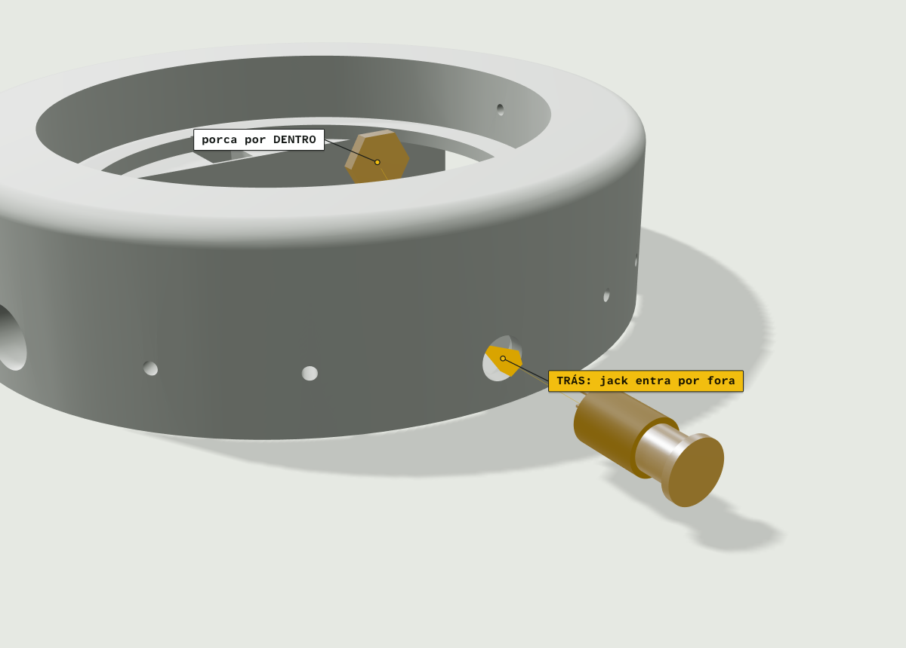

O jack entra **por fora**, pelo furo de Ø 8 da TRÁS do pedestal; a porca aperta **por dentro**, no rebaixo.

**Faça:**

1. Passe os fios do jack pelo furo, de fora para dentro.
2. Empurre o jack até a aba encostar na parede.
3. Rosqueie a porca por dentro e aperte com o alicate (sem exagero).

✅ **Confira antes de seguir:**

- [ ] O jack não gira quando você encaixa o plugue da fonte.

### C.4 Chave, botão e LED na lateral direita

🔧 Mecânica · 🧴 Cola · ⏱ 10 min

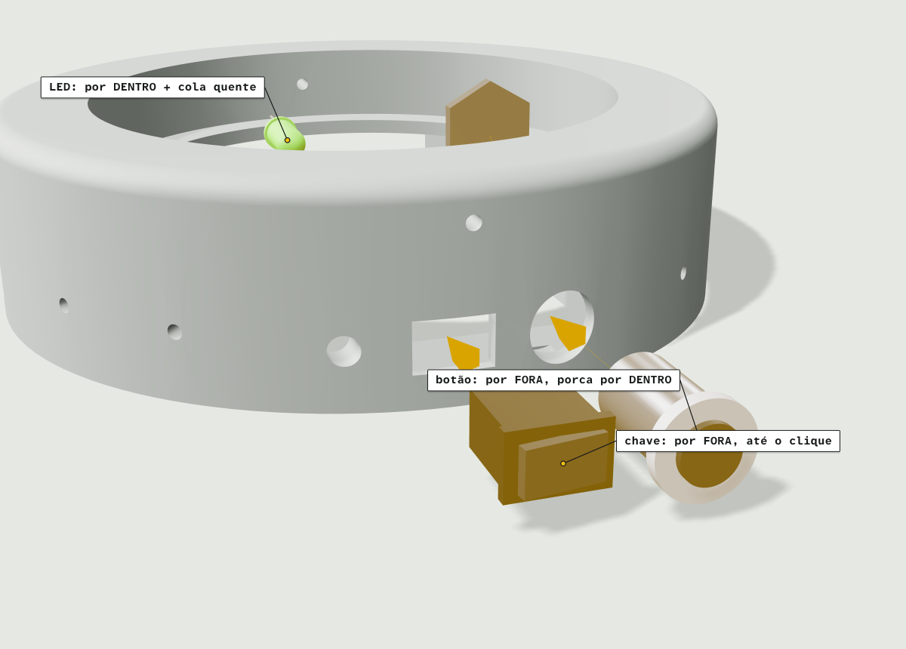

Na lateral **DIREITA** do pedestal, de frente para trás: **LED** (furo pequeno), **chave** (recorte retangular) e **botão** (furo de 12 mm).

**Faça:**

1. **Chave:** passe os fios pelo recorte de fora para dentro e empurre a chave até travar (clique). O "I" (ligado) fica para cima.
2. **Botão:** passe os fios pelo furo de 12 mm, de fora para dentro; rosqueie a porca **por dentro**, no rebaixo.
3. **LED:** por **dentro** do pedestal, empurre o LED no furo pequeno até a aba encostar; prenda com uma gota de **cola quente** por dentro.
4. Leve todos os fios para a **cavidade central** do pedestal.

✅ **Confira antes de seguir:**

- [ ] Chave firme; botão não gira; LED não sai empurrando por fora.

### C.5 Ímãs da gaveta

🧴 Cola · ⏱ 10 min (+ secagem)

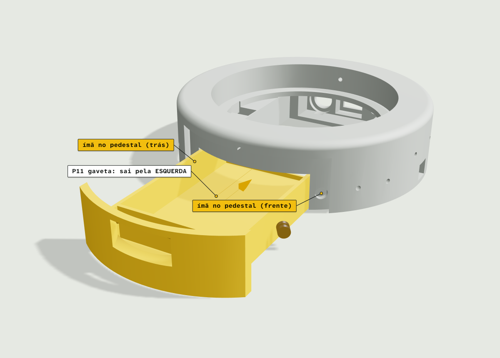

4 ímãs de 6 × 2 mm: **2 no rebaixo do pedestal** (lado esquerdo) e **2 nas pontas da aba da gaveta**. A polaridade importa: com ela invertida, a gaveta é empurrada para fora.

**Separe:**

| Qtd | Item |
|---|---|
| 4 | ímãs de neodímio disco 6 × 2 mm |
| — | cola instantânea **gel** |

**Faça:**

1. Cole os **2 ímãs do pedestal** nos furinhos do rebaixo (gota de cola no fundo, ímã rente).
2. Pegue um ímã solto e **encoste no ímã do pedestal**: a face que ficou **grudada** é a que fica virada **para fora** da aba da gaveta.
3. Cole os 2 ímãs da aba assim (cada um no seu par). Espere a cola secar (5 min).

> ⚠️ **Atenção**
> - Ímã engolido é perigoso para pet e criança: cole bem e confira de vez em quando.

✅ **Confira antes de seguir:**

- [ ] Com a gaveta encostada, ela **puxa** para dentro (não empurra).

### C.6 Pilhas na gaveta e gaveta no pedestal

🔧 Mecânica · ✅ Teste · ⏱ 10 min

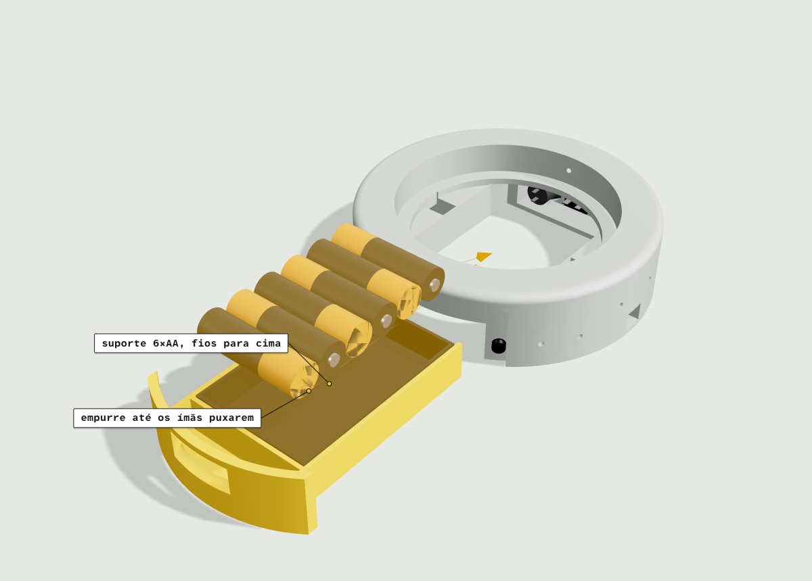

O suporte chato com as 6 AA fica no berço da gaveta, **fios para cima**, com **~15 cm de folga** (é o que deixa a gaveta abrir sem desligar nada). A gaveta entra pela ESQUERDA.

**Separe:**

| Qtd | Item |
|---|---|
| 6 | pilhas AA alcalinas |
| 1 | suporte 6 × AA chato com fios |

**Faça:**

1. Ponha as 6 pilhas no suporte (polaridade marcada nele).
2. Encaixe o suporte no berço da gaveta. É justo: não precisa de fita (se usar, só fita **fina ≤ 0,5 mm**).
3. Se os fios do suporte forem curtos, emende até ~25 cm (solda + termorretrátil) com pino macho na ponta.
4. Empurre a gaveta pela esquerda até os ímãs puxarem; os fios saem por cima da gaveta para a cavidade central.

✅ **Confira antes de seguir:**

- [ ] Multímetro: fonte na tomada, entre os fios do jack → **~12 V**; nos fios das pilhas → **~9 V**.
- [ ] A gaveta abre e fecha 3 vezes sem prender os fios.

## D — Eletrônica na protoboard

Regulador em 5 V, componentes furo a furo, jumpers, ESP32 e gravação do firmware. Fazer numa mesa limpa.

### D.1 Regulador MP1584: pinos e 5,0 V

🔥 Solda · 🔌 Eletrônica · 📏 Medir/marcar · ⏱ 20 min

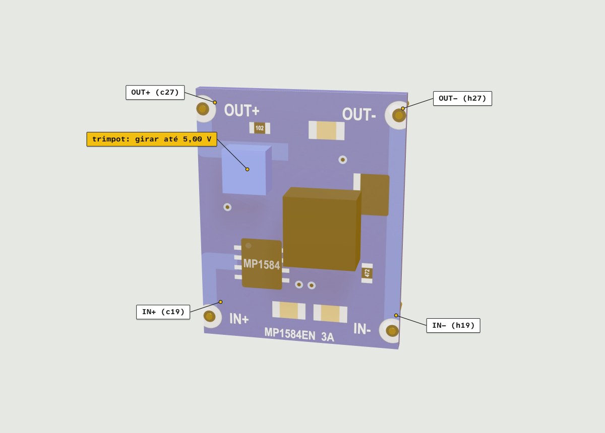

**Faça isto antes de qualquer outra coisa.** O regulador sai de fábrica numa tensão qualquer: ligado assim, queima a ESP32 e o servo.

**Separe:**

| Qtd | Item |
|---|---|
| 1 | módulo MP1584EN — tem 2: o outro é reserva |
| 4 | pinos de barra macho |
| 1 | fonte 12 V |

**Ferramentas:** ferro de solda, multímetro, chave de fenda de relojoeiro.

**Faça:**

1. Solde 4 pinos nos furos **IN+, IN−, OUT+, OUT−**, com os pinos saindo pelo lado de **trás** da placa (o lado sem o indutor).
2. Ligue **só** o MP1584 na fonte 12 V: + no IN+, − no IN−.
3. Multímetro em V DC no OUT+ / OUT−. Gire o trimpot devagar até marcar **5,00 V** (sentido anti-horário costuma baixar).
4. Desligue a fonte.

> ⚠️ **Atenção**
> - O trimpot é minúsculo e quebra: gire com delicadeza. Pode precisar de **várias voltas**.

✅ **Confira antes de seguir:**

- [ ] Desligou e ligou de novo a fonte: continua **5,0 V** (± 0,05).

### D.2 Protoboard na espinha da bandeja

🔧 Mecânica · 🧴 Cola · ⏱ 10 min

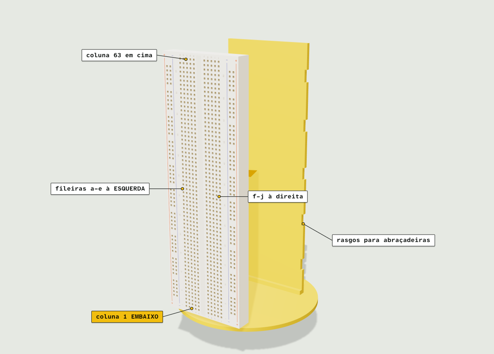

A MB-102 fica **em pé** na espinha da bandeja (P05), furos para a **FRENTE**, **coluna 1 embaixo**, apoiada no batente de baixo. A partir daqui, tudo é feito com ela em pé (ou deitada de costas na mesa).

| Trilho (olhando de frente) | Cor | Uso |
|---|---|---|
| esquerdo externo | vermelho | **+5 V** |
| esquerdo interno | azul | **GND** |
| direito interno | azul | **GND** |
| direito externo | vermelho | **+3,3 V** |

**Separe:**

| Qtd | Item |
|---|---|
| 1 | P05 bandeja + espinha |
| 1 | protoboard MB-102 (830 furos) |
| 2 | abraçadeiras 2,5 × 100 |

**Faça:**

1. Confira a numeração impressa na protoboard: a **coluna 1** vai para **baixo** (lado da bandeja).
2. Tire o papel do verso e cole na espinha, com a borda de baixo apoiada no batente.
3. Reforce com **2 abraçadeiras** pelos rasgos da espinha (uma em cima, uma no meio).
4. Com caneta, escreva "+5V" no trilho esquerdo externo e "+3V3" no direito externo (eles **não** são ligados entre si).

✅ **Confira antes de seguir:**

- [ ] Protoboard reta, sem folga; os trilhos da esquerda estão à esquerda olhando de frente.

### D.3 Diodos D1 e D2 (o "OU" fonte/pilhas)

🔌 Eletrônica · ⏱ 5 min

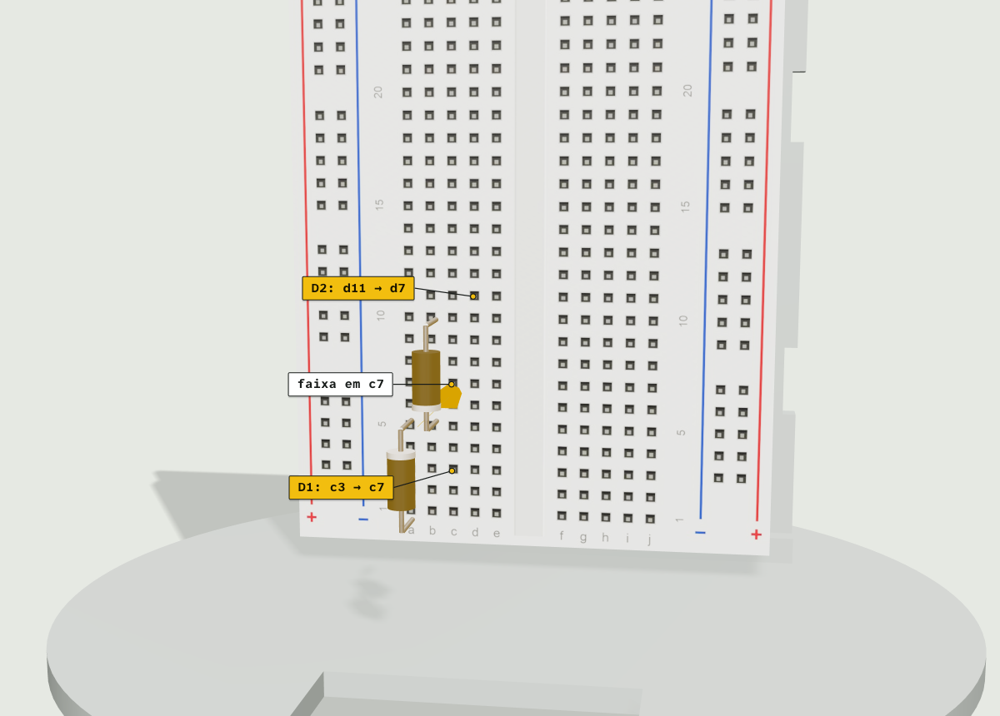

Dois diodos 1N5819 juntam a fonte e as pilhas no mesmo ponto (coluna 7). A **faixa cinza** (catodo) de **ambos** fica na **coluna 7**.

| Peça | Perna sem faixa (anodo) | Perna com faixa (catodo) |
|---|---|---|
| D1 1N5819 (fonte) | **c3** | **c7** |
| D2 1N5819 (pilhas) | **d11** | **d7** |

**Separe:**

| Qtd | Item |
|---|---|
| 2 | diodo Schottky 1N5819 |

**Faça:**

1. Dobre as pernas no passo certo (4 furos de distância) com o alicate.
2. Encaixe D1 e D2 nos furos da tabela, até o corpo encostar na protoboard.

✅ **Confira antes de seguir:**

- [ ] As **duas** faixas estão na coluna 7.

### D.4 Divisores de tensão e resistor do LED

🔌 Eletrônica · ⏱ 15 min

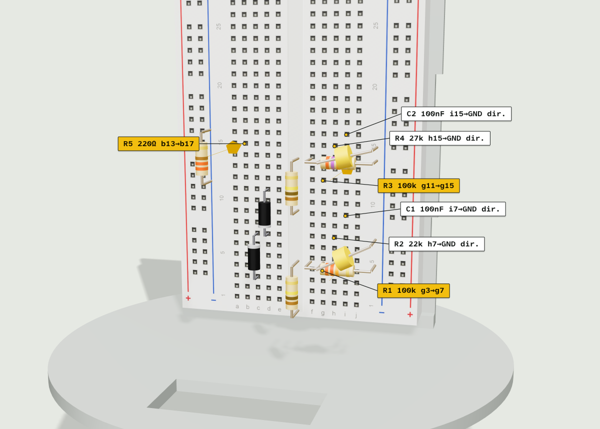

Dois divisores deixam a ESP32 medir a fonte (GPIO 35) e as pilhas (GPIO 34). Cada um: resistor de cima (100 kΩ), resistor de baixo até o GND e um capacitor de 100 nF para filtrar. Mais o 220 Ω do LED.

| Peça | Cores (anéis) | De | Para |
|---|---|---|---|
| R1 100 kΩ | marrom-preto-amarelo | **g3** | **g7** |
| R2 22 kΩ | vermelho-vermelho-laranja | **h7** | trilho GND direito, col. **7** |
| C1 100 nF (104) | — | **i7** | trilho GND direito, col. **9** |
| R3 100 kΩ | marrom-preto-amarelo | **g11** | **g15** |
| R4 27 kΩ | vermelho-violeta-laranja | **h15** | trilho GND direito, col. **15** |
| C2 100 nF (104) | — | **i15** | trilho GND direito, col. **16** |
| R5 220 Ω | vermelho-vermelho-marrom | **b13** | **b17** |

**Separe:**

| Qtd | Item |
|---|---|
| 2 | resistor 100 kΩ |
| 1 | resistor 22 kΩ |
| 1 | resistor 27 kΩ |
| 1 | resistor 220 Ω |
| 2 | capacitor cerâmico 100 nF (104) |

**Faça:**

1. Confira cada resistor com o multímetro antes de encaixar (as cores enganam).
2. Encaixe na ordem da tabela, pernas curtas e rentes.

> ⚠️ **Atenção**
> - R2 (22k) é da **fonte** e R4 (27k) das **pilhas**: trocados, a leitura de bateria fica errada.

✅ **Confira antes de seguir:**

- [ ] Nenhuma perna encosta em outra.
- [ ] R2, R4, C1 e C2 terminam no trilho **GND da direita** (azul), não no +3V3 (vermelho, mais de fora).

### D.5 MP1584, HX711, capacitor 470 µF e conector do servo

🔌 Eletrônica · ⏱ 10 min

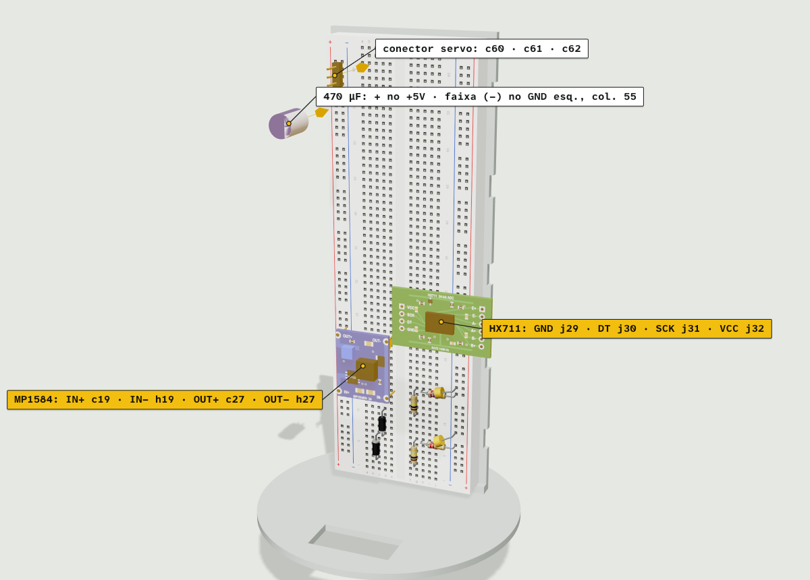

O regulador (já em 5,0 V) atravessa o canal do meio. O HX711 espeta na fileira **j** com a placa para fora, à direita. O 470 µF segura o pico do servo. O conector do servo fica no **topo**, para soltar o tubo.

**Separe:**

| Qtd | Item |
|---|---|
| 1 | MP1584 ajustado (D.1) |
| 1 | módulo HX711 |
| 1 | capacitor eletrolítico 470 µF ≥ 16 V |
| 1 | barra de 3 pinos macho |
| — | fita dupla-face de espuma |

**Faça:**

1. **MP1584:** pinos em **c19 (IN+), h19 (IN−), c27 (OUT+), h27 (OUT−)**. Confira as marcas na plaquinha: IN embaixo, OUT em cima.
2. **HX711:** os 4 pinos na fileira **j**: **GND j29, DT j30, SCK j31, VCC j32**. A placa fica para fora, à direita; ponha 2 camadas de fita de espuma atrás dela.
3. **470 µF:** perna **+** (longa) no trilho **+5V**, perna **−** (lado da faixa) no trilho **GND da esquerda**, coluna 55.
4. **Conector do servo:** barra de 3 pinos em **c60, c61, c62**.

> ⚠️ **Atenção**
> - Capacitor eletrolítico ao contrário **estoura**. A faixa (−) vai no GND.

✅ **Confira antes de seguir:**

- [ ] Os nomes impressos no HX711 batem com a tabela (GND, DT, SCK, VCC de baixo para cima). Se a ordem do seu módulo for outra, siga o nome, não a posição.

### D.6 Jumpers da protoboard (10 fios)

🔌 Eletrônica · ⏱ 15 min

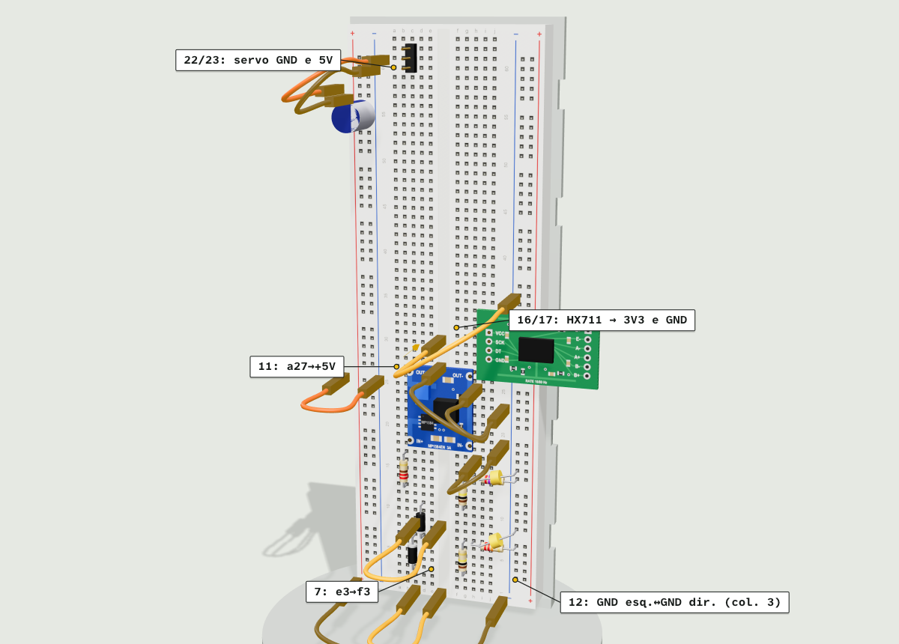

Pontes de alimentação e de GND. Use jumpers macho-macho curtos, nas cores da tabela (a cor não muda a ligação, mas ajuda a conferir).

| # | De | Para | Cor |
|---|---|---|---|
| 7 | e3 | f3 | laranja |
| 8 | e11 | f11 | laranja |
| 9 | j19 | GND dir., col. 21 | preto |
| 10 | j27 | GND dir., col. 25 | preto |
| 11 | a27 | +5V, col. 27 | vermelho |
| 12 | GND esq., col. 3 | GND dir., col. 3 | preto |
| 16 | f32 | +3V3, col. 37 | laranja |
| 17 | f29 | GND dir., col. 25 | preto |
| 22 | a60 | GND esq., col. 57 | preto |
| 23 | b61 | +5V, col. 58 | vermelho |

**Separe:**

| Qtd | Item |
|---|---|
| 10 | jumpers macho-macho |

✅ **Confira antes de seguir:**

- [ ] Multímetro em continuidade, **tudo desligado**: +5V ↔ GND **não** apita (um bip curtinho do capacitor carregando é normal); +3V3 ↔ GND **não** apita; GND esquerdo ↔ GND direito **apita** sem parar.

### D.7 ESP32 colada de cabeça para baixo

🔌 Eletrônica · 🧴 Cola · ⏱ 15 min

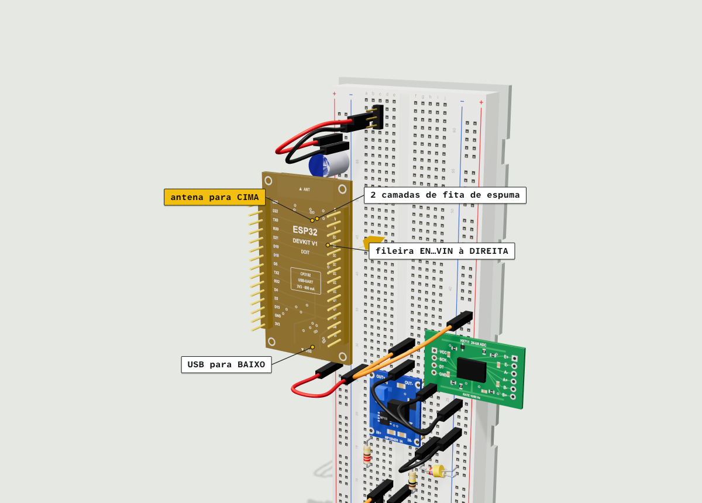

A ESP32 **não espeta** na protoboard: é colada **de cabeça para baixo** entre as colunas ~37 e 57, com **antena para cima** e **USB para baixo**. Os pinos ficam apontando para você e recebem jumpers **fêmea**.

**Separe:**

| Qtd | Item |
|---|---|
| 1 | ESP32 DevKit V1 30 pinos |
| — | fita dupla-face de espuma |

**Ferramentas:** caneta permanente fina.

**Faça:**

1. **Antes de colar**, vire a placa e marque com caneta, no lado de **baixo**, os pinos usados (os nomes só estão em cima): **VIN, GND (ao lado do VIN), 3V3, D18, RX2/16, D4, D34, D35, D23, D22**.
2. Cole **2 camadas** de fita de espuma sobre a blindagem metálica do módulo (a caixinha prateada).
3. Cole a placa de cabeça para baixo, centrada na protoboard, entre as colunas ~37 e 57: antena para cima, USB para baixo.

✅ **Confira antes de seguir:**

- [ ] O cabo USB encaixa na placa sem bater na protoboard.
- [ ] Olhando de frente, a fileira com VIN/GND/D34/D35 está à **direita**.

### D.8 Jumpers da ESP32 (10 fios)

🔌 Eletrônica · ⏱ 15 min

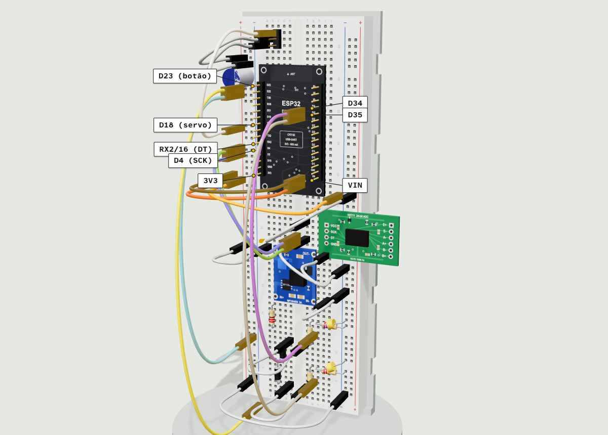

Jumpers **macho-fêmea**: a fêmea no pino da ESP32, o macho no furo da protoboard.

| # | Pino ESP32 | Vai para | Cor |
|---|---|---|---|
| 13 | **VIN** | +5V, col. 39 | vermelho |
| 14 | **GND** (ao lado do VIN) | GND esq., col. 40 | preto |
| 15 | **3V3** | +3V3, col. 38 | laranja |
| 18 | **RX2/16** | g30 (HX711 DT) | verde |
| 19 | **D4** | g31 (HX711 SCK) | azul |
| 20 | **D34** | j15 (divisor das pilhas) | roxo |
| 21 | **D35** | j7 (divisor da fonte) | cinza |
| 24 | **D18** | e62 (sinal do servo) | branco |
| 26 | **D23** | b1 (botão) | amarelo |
| 28 | **D22** | a13 (resistor do LED) | ciano |

**Separe:**

| Qtd | Item |
|---|---|
| 10 | jumpers macho-fêmea |

> ⚠️ **Atenção**
> - **VIN** recebe 5 V. Nunca ligue 5 V no pino **3V3** (queima a placa).

✅ **Confira antes de seguir:**

- [ ] Continuidade: pino VIN ↔ trilho +5V; pino GND ↔ trilho GND; pino 3V3 ↔ trilho +3V3.

### D.9 Teste na bancada e gravar o firmware

✅ Teste · 🔌 Eletrônica · ⏱ 30 min

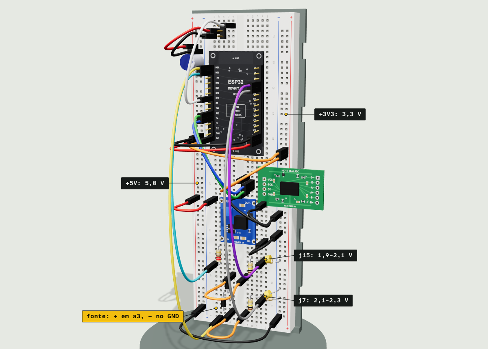

Primeiro só com a fonte (sem USB), medindo tensões. Depois só com a USB, gravando o firmware. **Nunca as duas juntas.**

**Faça:**

1. Ligue a fonte 12 V provisoriamente: **+ no furo a3**, **− no trilho GND esquerdo** (ou já use o jack do pedestal, passo G.2).
2. Ponha um jumper provisório de **a7 a a19** (faz o papel da chave).
3. Meça com o multímetro: trilho +5V = **5,0 V**; trilho +3V3 = **3,3 V**; j7 ≈ **2,1–2,3 V**; j15 = 0 V (sem pilhas, normal).
4. Desligue a fonte. Tire o jumper a7–a19.
5. Só com a USB no computador, grave o firmware (`cd firmware && pio run -t upload`). Depois as atualizações vão pelo Wi-Fi.
6. Abra o monitor serial (`pio device monitor`): o boot aparece sem reiniciar em loop.

> ⚠️ **Atenção**
> - Nunca ligue a USB com a fonte ou as pilhas ligadas.

✅ **Confira antes de seguir:**

- [ ] As 3 tensões batem.
- [ ] O LED azul da ESP32 acende e o serial mostra o boot.

## E — Balança

Célula de carga entre a base e a plataforma, com os 3 batentes de proteção.

### E.1 Estender os fios da célula

🔥 Solda · ⏱ 15 min

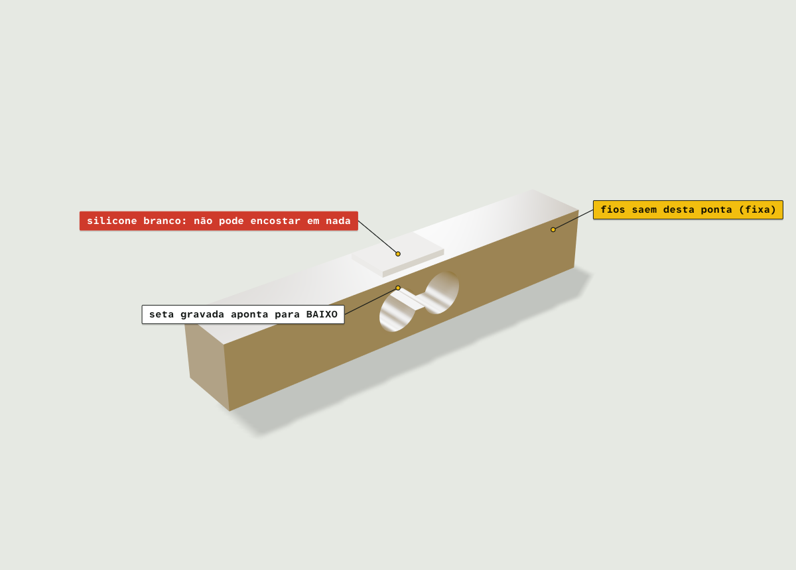

Os 4 fios da célula (~20 cm) não chegam ao HX711. Emende **~35 cm** de cabo 4 vias, **mesmas cores**, e isole cada emenda.

| Fio da célula | Vai no HX711 |
|---|---|
| vermelho | **E+** |
| preto | **E−** |
| branco | **A−** |
| verde | **A+** |

**Separe:**

| Qtd | Item |
|---|---|
| 1 | célula de carga 5 kg |
| ~35 cm | cabo 4 vias (de preferência trançado) |
| — | termorretrátil |

**Faça:**

1. Emende cor com cor, cada emenda com termorretrátil.
2. Trance levemente os 4 fios (menos ruído).
3. Deixe as pontas soltas: elas são soldadas no HX711 na montagem final (G.4).

✅ **Confira antes de seguir:**

- [ ] Multímetro: vermelho ↔ preto ≈ 1 kΩ; verde ↔ branco ≈ 1 kΩ (varia por fabricante; o importante é não estar aberto).

### E.2 Célula na base (lado fixo)

🔧 Mecânica · 🔩 Parafusos · ⏱ 10 min

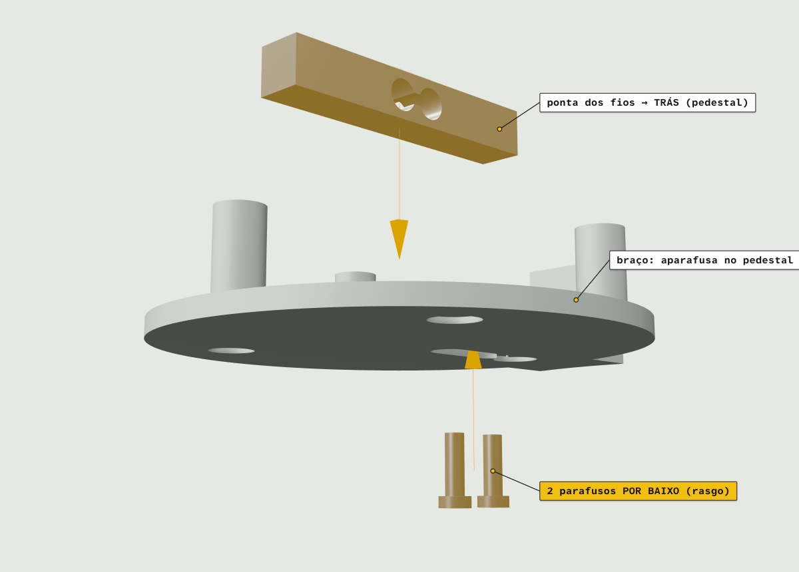

A célula fica **em balanço**: a ponta de trás (a dos fios) presa no bloco da base; a ponta da frente livre, segurando a plataforma. **Seta para baixo.**

**Separe:**

| Qtd | Item |
|---|---|
| 1 | P07 base da balança |
| 1 | célula com fios estendidos |
| 2 | M4 × 16 ou M5 × 16 — igual à rosca da célula; prefira M4 |

**Ferramentas:** chave Phillips #2.

**Faça:**

1. Ponha a célula sobre o bloco da base com a **ponta dos fios para trás** (para o braço) e a **seta para baixo**.
2. Vire o conjunto e aparafuse **2 parafusos por baixo**, pelo rasgo; a cabeça fica no rebaixo.

✅ **Confira antes de seguir:**

- [ ] A ponta da frente da célula fica no ar, sem tocar a base.

### E.3 Espaçador e plataforma (lado livre)

🔧 Mecânica · 🔩 Parafusos · ⏱ 10 min

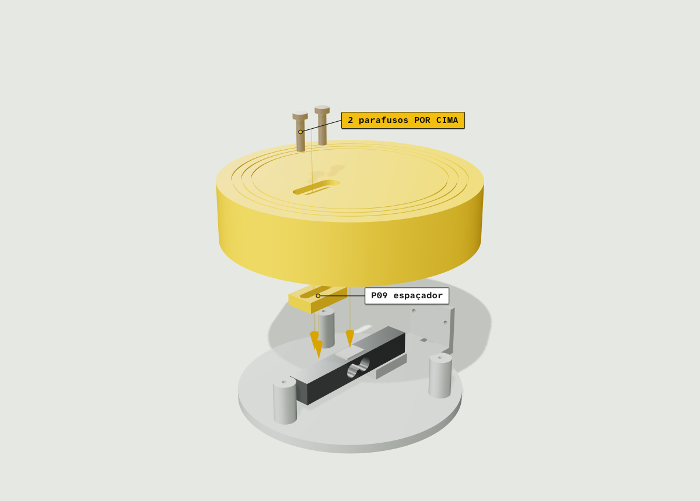

O espaçador (P09) vai entre a ponta livre da célula e a plataforma (P08); 2 parafusos **por cima** atravessam a plataforma e o espaçador e rosqueiam na célula.

**Separe:**

| Qtd | Item |
|---|---|
| 1 | P09 espaçador |
| 1 | P08 plataforma |
| 2 | M4 × 16 (ou M5 × 16 de cabeça **chata**) |

**Faça:**

1. Apoie o espaçador na ponta livre da célula, furos alinhados.
2. Ponha a plataforma por cima (sulcos da vasilha para cima).
3. Aparafuse os **2 parafusos por cima**, cabeças no rebaixo.

✅ **Confira antes de seguir:**

- [ ] A saia da plataforma **não encosta** na base em nenhum ponto.

### E.4 Batentes de sobrecarga

🔩 Parafusos · 📏 Medir/marcar · ⏱ 10 min

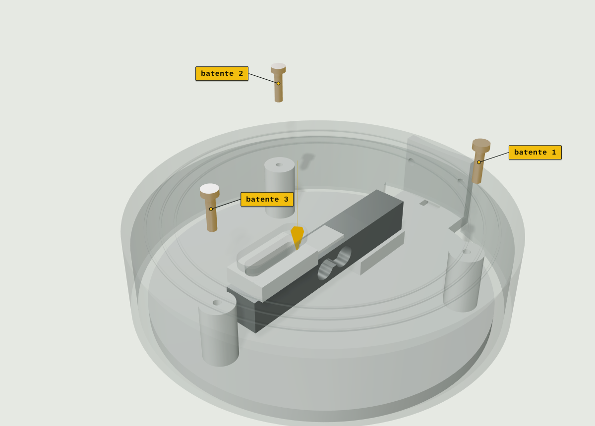

3 parafusos M3 × 12 rosqueados nos postes da base. A **cabeça** fica **~1 mm abaixo** da plataforma: se o pet subir, a plataforma apoia nos batentes e a célula não entorta.

**Separe:**

| Qtd | Item |
|---|---|
| 3 | M3 × 12 inox cabeça panela |

**Faça:**

1. Rosqueie um parafuso em cada poste (dá para fazer antes de pôr a plataforma e ajustar depois por baixo dela).
2. Ajuste a altura: uma folha de papel dobrada 3 vezes (~1 mm) entre a cabeça e a plataforma tem que passar justa.

✅ **Confira antes de seguir:**

- [ ] Apertando a plataforma com o dedo ela desce ~1 mm e para nos batentes; soltando, volta e fica **livre**.

## F — Patas com lastro

Encher as 4 patas com peso, colar as tampas e os pés de borracha.

### F.1 Lastro, tampas e pés das 4 patas

🧴 Cola · ⏱ 30 min

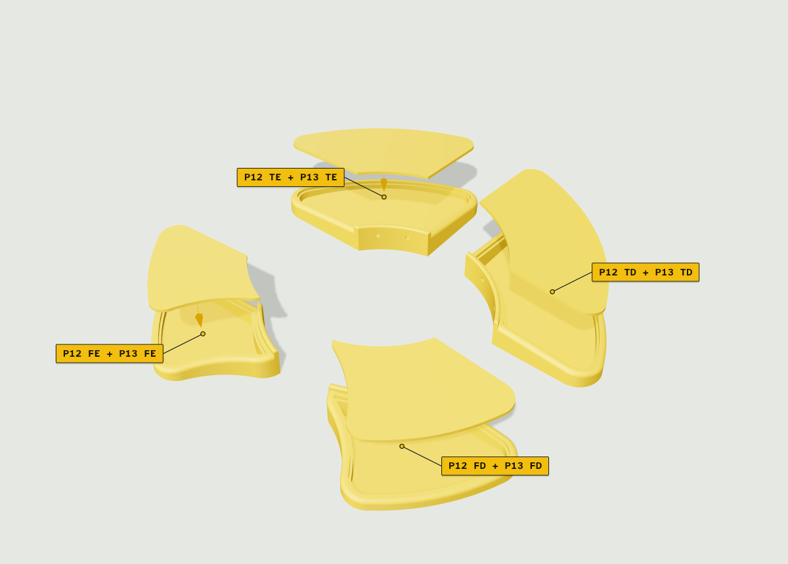

Cada pata tem um bolso para peso. Enche, cola a tampa de **mesmo nome** (rente ao topo) e cola o pé de borracha embaixo da ponta. **TD** = trás-direita, **TE** = trás-esquerda, **FE** = frente-esquerda, **FD** = frente-direita.

**Separe:**

| Qtd | Item |
|---|---|
| 4 | P12 patas (TD, TE, FE, FD) |
| 4 | P13 tampas (TD, TE, FE, FD) |
| ~0,5 kg | porcas M8 ou arruelas de aço — ou ~185 g de areia seca em saquinho |
| 4 | pés de borracha Ø 12 (iguais aos do pedestal) |

**Faça:**

1. Encha o bolso de cada pata com porcas/arruelas (~120 g por pata), sem passar do degrau da tampa.
2. Passe cola (instantânea gel ou quente) no degrau e encaixe a **tampa de mesmo nome**: ela fica rente ao topo.
3. Cole um pé de borracha no rebaixo embaixo da ponta de cada pata.

> ⚠️ **Atenção**
> - Não use chumbo (chumbada de pesca), ímãs nem pilhas velhas como lastro.

✅ **Confira antes de seguir:**

- [ ] Nenhuma peça chacoalha dentro da pata.
- [ ] As tampas não ficam acima do topo.

## G — Montagem final

Juntar os módulos: eletrônica no pedestal, ligações, balança, teste geral, tubo, patas, calibração.

### G.1 Bandeja com a eletrônica no pedestal

🔧 Mecânica · ⏱ 5 min

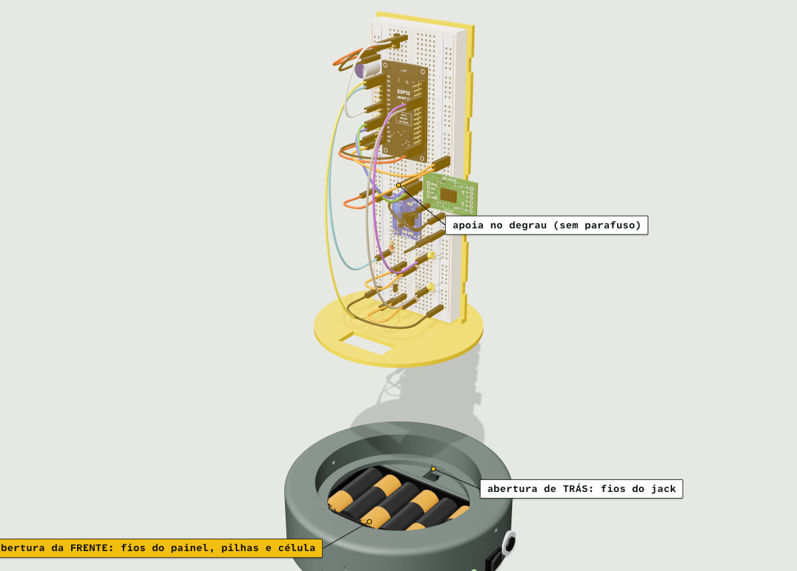

A bandeja (com a protoboard pronta do módulo D) **apoia** no degrau interno do pedestal, sem parafuso. Os fios do pedestal sobem pela **abertura da frente** da bandeja; os do jack pela **abertura de trás**.

**Faça:**

1. Passe os fios do painel e das pilhas pela abertura da frente da bandeja e os do jack pela de trás.
2. Desça a bandeja até apoiar no degrau, com a protoboard virada para a **FRENTE** (lado da canaleta da balança).

✅ **Confira antes de seguir:**

- [ ] A bandeja assenta reta e nenhum fio ficou preso embaixo dela.

### G.2 Ligar os fios do pedestal

🔌 Eletrônica · ⏱ 15 min

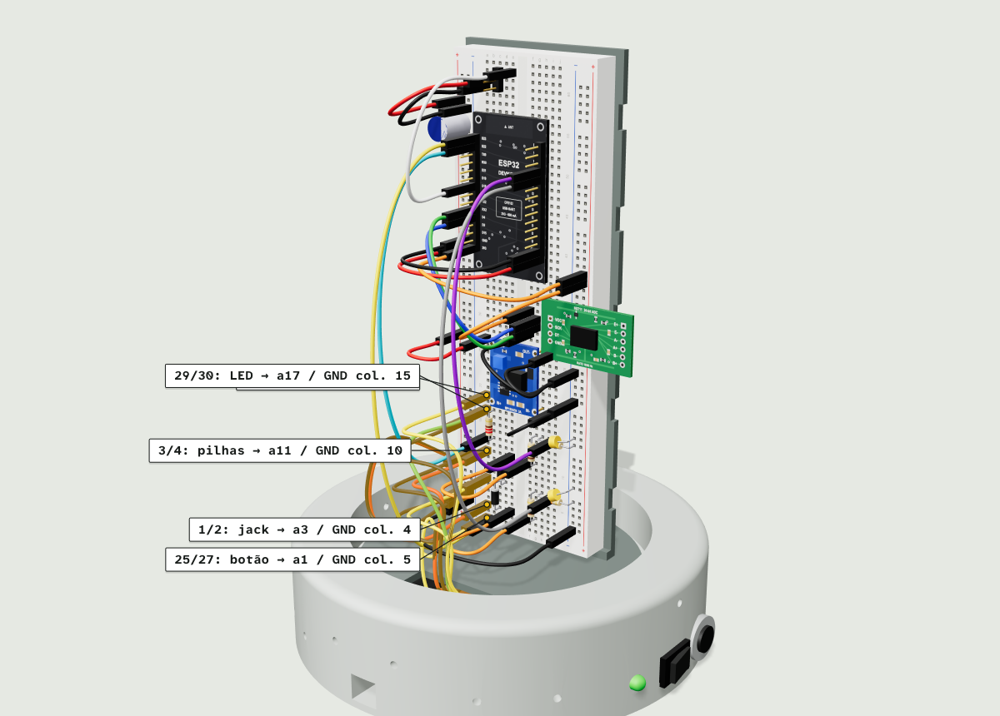

Os 10 fios do jack, pilhas, chave, botão e LED espetam na protoboard (pontas macho). Confira a etiqueta de cada um.

| # | Fio | Furo |
|---|---|---|
| 1 | Jack J+ vermelho | **a3** |
| 2 | Jack J− preto | GND esq., col. **4** |
| 3 | Pilhas + vermelho | **a11** |
| 4 | Pilhas − preto | GND esq., col. **10** |
| 5 | Chave SW1 amarelo | **a7** |
| 6 | Chave SW2 amarelo | **a19** |
| 25 | Botão BT amarelo | **a1** |
| 27 | Botão BT− preto | GND esq., col. **5** |
| 29 | LED+ verde | **a17** |
| 30 | LED− preto | GND esq., col. **15** |

> ⚠️ **Atenção**
> - Chave geral **desligada** e fonte **fora da tomada** durante as ligações.

✅ **Confira antes de seguir:**

- [ ] Os 10 fios estão nos furos certos (confira pela etiqueta, não pela cor).
- [ ] Folga de ~15 cm nos fios das pilhas: a gaveta ainda abre.

### G.3 Balança no pedestal

🔩 Parafusos · ⏱ 10 min

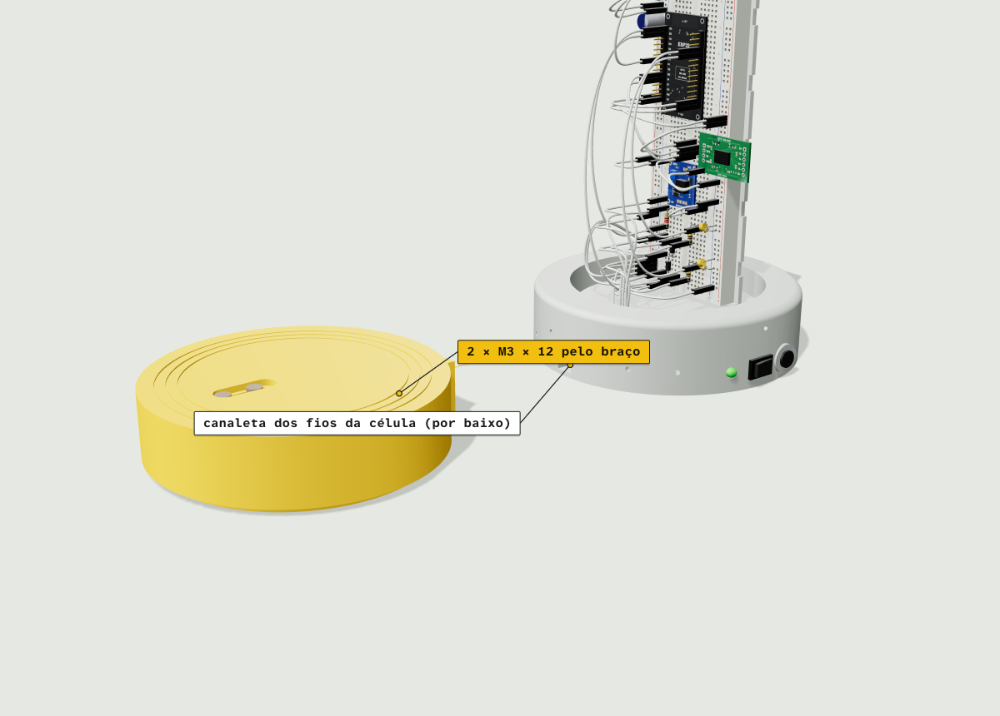

O braço da base da balança encosta na **frente** do pedestal e é preso por **2 × M3 × 12**. Os fios da célula vão pela **canaleta** embaixo do pedestal e sobem pela chaminé da frente.

**Separe:**

| Qtd | Item |
|---|---|
| 1 | balança montada (módulo E) |
| 2 | M3 × 12 |

**Faça:**

1. Passe os 4 fios da célula pela canaleta da frente (por baixo do pedestal) e suba pela chaminé até a abertura da frente da bandeja.
2. Encoste a aba do braço na frente do pedestal e aparafuse **2 × M3 × 12**.

✅ **Confira antes de seguir:**

- [ ] A plataforma continua **livre** (só a célula a segura) e não encosta no pedestal.

### G.4 Soldar a célula no HX711

🔥 Solda · ⏱ 10 min

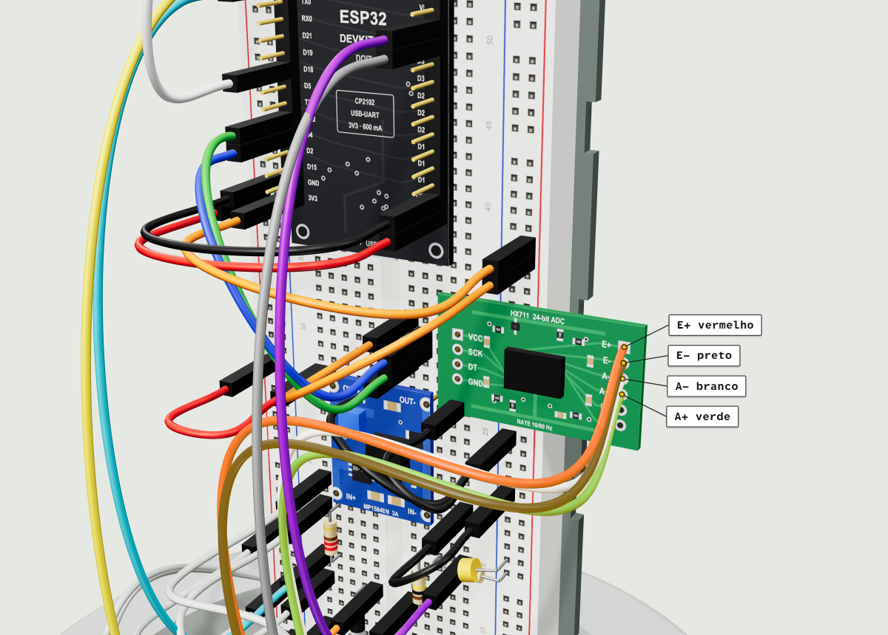

Os 4 fios da célula soldam nos furos da ponta direita do HX711: **E+, E−, A−, A+**.

**Faça:**

1. Solde cada fio no furo do nome certo, por trás da placa ou por cima, sem encostar estanho entre furos vizinhos.
2. Prenda o cabo na espinha com uma abraçadeira, com folga.

> ⚠️ **Atenção**
> - Se no teste o peso der **negativo**, troque A+ com A−.

✅ **Confira antes de seguir:**

- [ ] Sem pontes de solda entre os furos E+/E−/A−/A+.

### G.5 Teste geral antes de fechar

✅ Teste · 🔌 Eletrônica · ⏱ 20 min

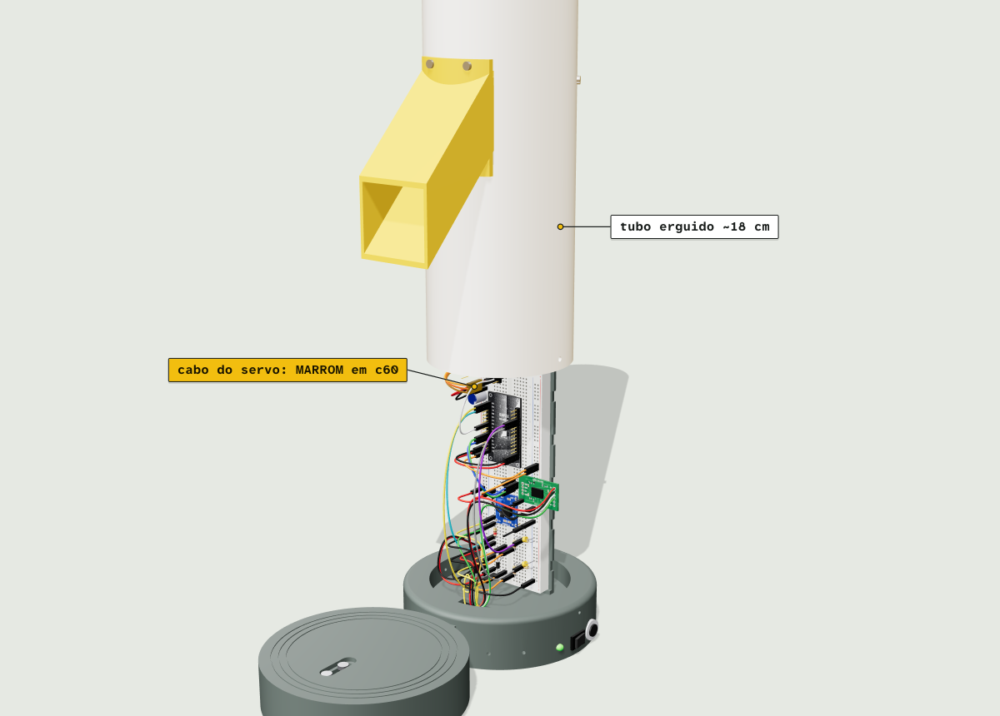

Com o tubo ainda **fora**, segurado ~18 cm acima do pedestal, ligue o servo e teste tudo. Corrigir agora é fácil; depois tem que tirar o tubo.

**Faça:**

1. Um colega segura o tubo (com cartucho e bica) uns **18 cm** acima do pedestal.
2. Encaixe o conector do servo nos pinos **c60–c62**: **marrom em c60** (GND), vermelho c61, laranja c62.
3. Fonte na tomada → **ligue a chave**. O LED do pedestal pisca devagar (ainda sem Wi-Fi).
4. Pelo serial ou pelo app: balança muda ao apertar a plataforma; botão é reconhecido; bateria aparece.
5. **Ajuste o "parado" do servo** (`servo_trim` / App → Ajustes → Servo) até o rotor ficar **totalmente parado**.
6. Mande "avançar" e "recuar": o rotor gira suave nos dois sentidos.
7. Desligue a chave e tire a fonte da tomada.

✅ **Confira antes de seguir:**

- [ ] Rotor parado de verdade em "parado".
- [ ] ESP32 não reinicia quando o servo gira (se reiniciar: confira 5,0 V e o 470 µF).

### G.6 Tubo no pedestal

🔧 Mecânica · 🔩 Parafusos · ⏱ 10 min

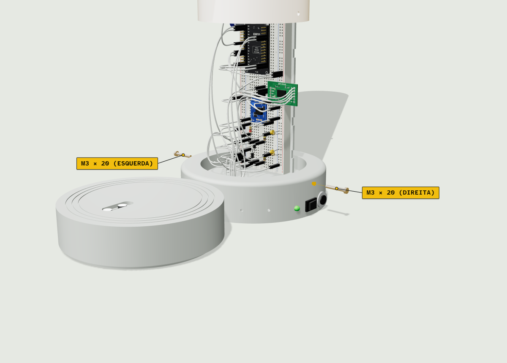

Desça o tubo no **soquete** do pedestal: a protoboard e a bandeja entram por dentro dele. A **janela/bica** fica para a **FRENTE** (lado da balança). Trave com **2 × M3 × 20** nas laterais.

**Separe:**

| Qtd | Item |
|---|---|
| 2 | M3 × 20 |

**Faça:**

1. Desça o tubo devagar, guiando os fios para não prender nenhum na borda.
2. Gire até o furo de 7,5 mm de cada lateral alinhar com o furo do pedestal.
3. Aparafuse **2 × M3 × 20** pelas laterais do pedestal: o parafuso rosqueia no pedestal e a ponta entra no furo do tubo como pino.

✅ **Confira antes de seguir:**

- [ ] Tubo assentado até o fundo do soquete.
- [ ] A bica fica centrada sobre a plataforma.

### G.7 Patas no pedestal

🔩 Parafusos · ⏱ 15 min

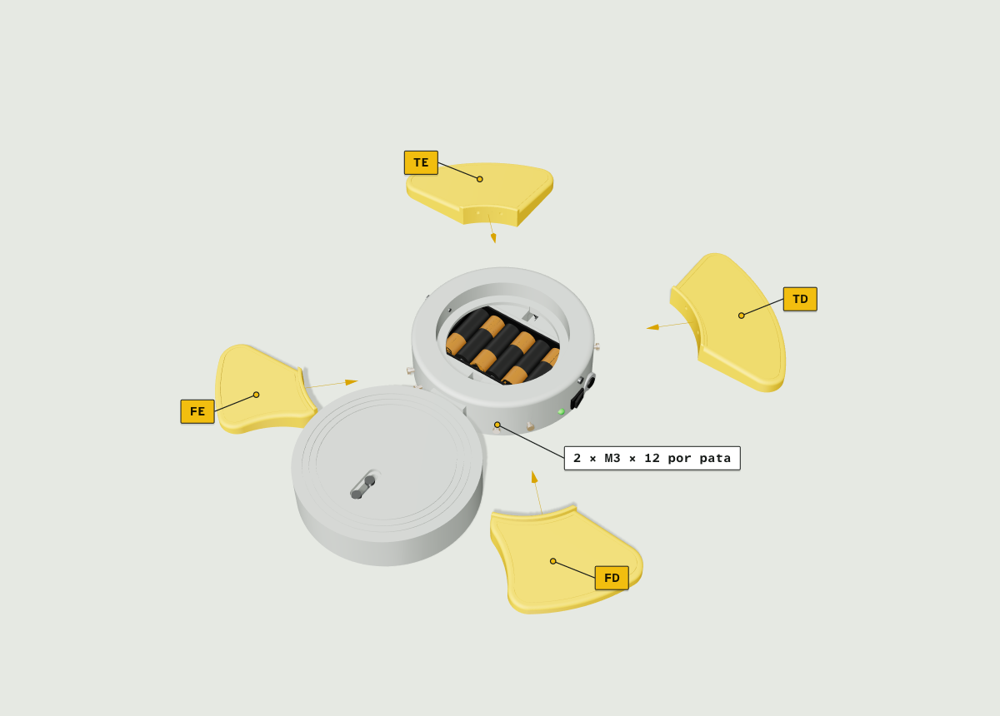

Cada pata só encaixa no seu lugar. A aba abraça o pedestal e leva **2 × M3 × 12**.

**Separe:**

| Qtd | Item |
|---|---|
| 4 | patas prontas (módulo F) |
| 8 | M3 × 12 |

**Faça:**

1. Encoste cada pata no seu lugar (TD trás-direita…).
2. Aperte **2 × M3 × 12** por pata, pela aba, até encostar.

✅ **Confira antes de seguir:**

- [ ] A gaveta abre entre as patas.
- [ ] A plataforma da balança não encosta em nenhuma pata.
- [ ] O alimentador não balança (os 8 pés tocam a mesa).

### G.8 Vasilha, cap e calibração

✅ Teste · ⏱ 40 min

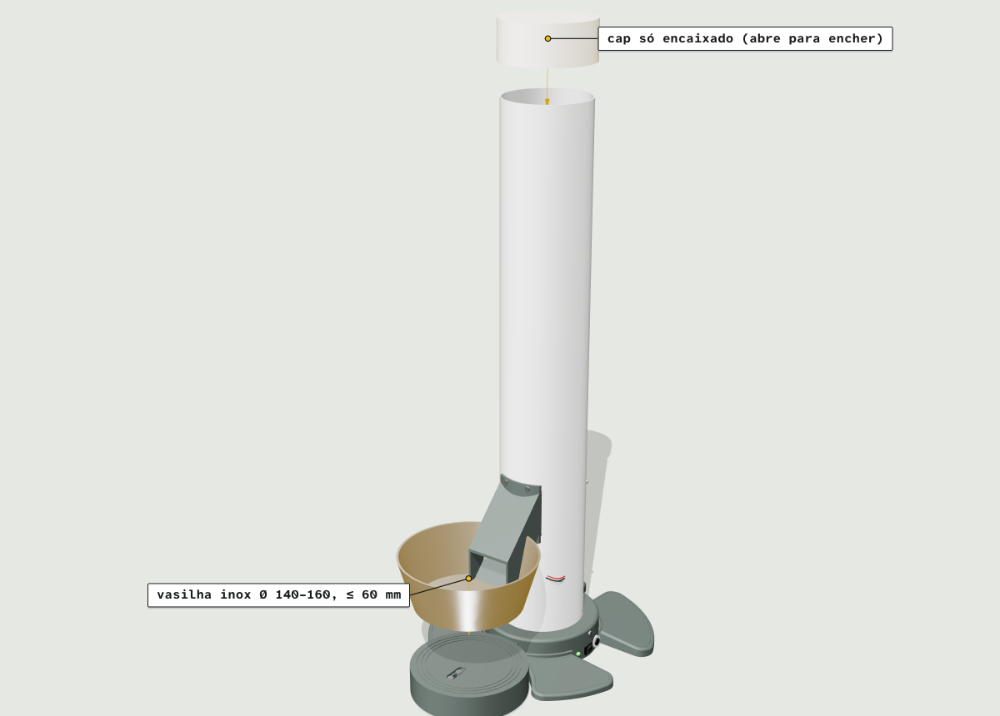

Montado! Falta ligar, configurar o Wi-Fi, calibrar e encher.

**Faça:**

1. Chave desligada → fonte na tomada → liga a chave. LED pisca devagar.
2. No celular, conecte na rede **"Alimentador-XXXXXX"** com a **senha da etiqueta** e escolha o Wi-Fi da casa.
3. No app: parear → **calibrar a balança** (plataforma vazia → peso conhecido, ex. pacote de 500 g → vasilha vazia).
4. **Calibrar a bateria**: meça as pilhas com o multímetro e digite a tensão.
5. Encha o tubo até ~2 cm da borda, encaixe o **cap** e toque **"Reabasteci"**.
6. Faça **5 refeições de 20 g** conferindo no app.
7. Tire a fonte da tomada: o app mostra **"usando pilhas"**. Recoloque.

✅ **Confira antes de seguir:**

- [ ] Erro das 5 doses ≤ 3 g.
- [ ] Nenhum reinício.
- [ ] App mostra bateria, nível de ração e vasilha.
